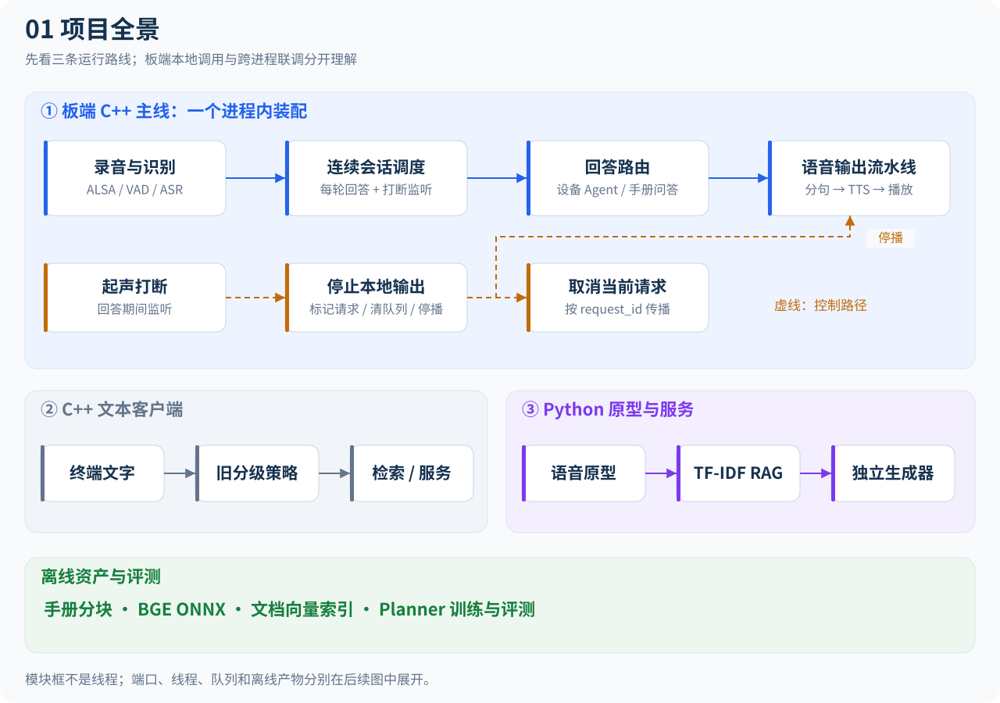

# EdgeVoiceRAG

面向 RK3588 的端侧语音助手与受约束设备 Agent。C++17 主程序把语音采集、VAD、ASR、车辆手册检索、LLM、TTS 和播放连接起来；设备操作由工具白名单、参数校验和用户确认控制。PC/WSL 使用 Mock 和离线测试完成开发，硬件相关能力再到 RK3588 验证。

**当前阶段重点：完成RK3588板端C++主线。** 优先完善连续语音、本地检索/RKLLM、设备Agent、打断与线程回收，并用PC/WSL Mock辅助验证。ZeroMQ示例、独立网络服务及Python RAG/语音联调暂缓；板端本地运行无需启动这些服务。Python索引/模型资产工具按需使用。

## 文档导航

| 文档 | 阅读目的 |
| --- | --- |
| [智能体协作约定](AGENTS.md) | 后续开发接手、CMake维护、验证与文档同步规则 |
| [完整调用与线程图解](docs/project-flow.md) | 从全景、路由、线程泳道到正常完成、起声打断与跨进程调用的8张图 |
| [项目总览与模块设计](docs/project-guide.md) | 理解两条运行路线、模块职责、数据流和当前实现状态 |
| [接口参考](docs/api-reference.md) | 查找全部公共 C++ 头文件、关键方法、输入输出与生命周期约定 |
| [通信与数据格式](docs/protocols.md) | 查阅 ZeroMQ 端口、JSON 示例、工具参数和索引格式 |
| [构建、运行与验证](docs/development.md) | 在 PC/WSL 或 RK3588 构建、运行和排查依赖 |
| [性能观测与固定输入基线](docs/performance-guide.md) | 队列容量等待、BGE分段、原始样本、指纹与RSS口径 |
| [C++测试手册](docs/testing-guide.md) | 每项测试的功能、受控并发场景、固定种子压力与运行方法 |
| [板端主线诊断入门](docs/diagnostics.md) | 逐步建立Debug对照、ASan/UBSan构建和主线Mock检查 |
| [CMake 构建结构](docs/cmake-structure.md) | 了解根配置、模块子CMake、SDK依赖和测试开关 |
| [SenseVoice RKNN手动学习](docs/sensevoice-rknn-hands-on.md) | 独立参考、CPU/NPU对照、自编SDK与模型转换；由使用者逐步执行 |
| [技术栈补充与项目演进报告](docs/technology-roadmap.md) | 按图片中的六个方向安排开发任务、实验和验收 |
| [源码文件索引](docs/source-map.md) | 按文件定位 C++、Python、脚本、测试和驱动 |
| [目录迁移说明](docs/refactoring.md) | 查看本次目录调整的范围和验证结果 |
| [目录速览](structure.md) | 快速浏览仓库结构 |

## 快速开始：PC/WSL 文本与 Agent

以下命令在 Linux/WSL 的项目根目录执行。需要 C++17 编译器、CMake、ZeroMQ C/C++ 开发包和 nlohmann-json；无需 NPU 或语音模型即可构建默认目标。

```bash
cmake -S . -B build -DCMAKE_BUILD_TYPE=Debug
cmake --build build -j4
ctest --test-dir build --output-on-failure
./build/agent_demo
```

在 Agent 演示中依次输入“车内温度是多少”“打开空调”“确认”“关闭空调”“取消”。演示使用 Mock 设备及 Rule Planner，不依赖 LLM 服务。文本问答示例：

```bash
./build/edge_voice_rag --config config/app.conf --once "空调怎么打开"
```

本地 RAG 需要 `vector_db/chunks.json`；该目录被 Git 忽略，首次使用请按[开发文档](docs/development.md)生成。需要 LLM 的查询还需启动对应服务。

## 当前 CMake 构建结构

根 CMake 负责总装配；`cmake/` 集中维护功能开关与SDK查找；`src/` 的各模块子CMake维护源码；`apps/tests/tools` 分别管理程序、测试和工具。模块当前统一编入 `edge_voice_rag_core`。

默认构建开启测试、关闭六个可选后端；可用 `-DBUILD_TESTING=OFF` 创建部署构建。所有程序默认输出到构建根目录，现有 `./build/<program>` 使用方式保持兼容。

构建调用链与主要场景已收入[项目总览](docs/project-guide.md#9-cmake-构建组织)；完整目标、变量和维护示例见[CMake构建指南](docs/cmake-structure.md)。

## 主链路

[](docs/diagrams/01-project-overview.svg)

[打开完整调用与线程图解](docs/project-flow.md)：建议接着看[线程泳道](docs/project-flow.md#threads)、[正常完成](docs/project-flow.md#normal)和[起声打断](docs/project-flow.md#interrupt)。点击图片可打开大图。

板端入口是 `src/apps/board_voice_main.cpp`。文本入口 `src/apps/main.cpp` 使用较早的 `MultiLevelResponseSystem`，两者不是相同的策略流水线；Python RAG/语音路线用于跨进程联调与实验。

## 当前代码能力

| 能力 | 当前实现与边界 |
| --- | --- |
| C++ 语音流水线 | ALSA、Silero VAD、SenseVoice ASR、sherpa-onnx TTS；需显式开启构建选项和准备模型 |
| 流式输出与打断 | 分句、句子/音频有界队列、TTS/播放工作线程、取消后端 |
| RAG | BM25、BGE ONNX CPU 向量编码、Dense 索引、加权 RRF、相关性过滤 |
| LLM | Mock 与可选 RKLLM；Python 另有 Ollama/ZeroMQ 适配 |
| 设备 Agent | Rule/LLM Planner、五种工具、确认超时、多步限制、结构化执行日志 |
| Linux 设备 | IIO 温湿度读取已实现，含 DHT11 内核模块源码；空调/LED 当前仍为内存逻辑状态 |
| 训练评测 | Planner 数据生成、QLoRA 训练和离线输出评测；adapter 未形成已验证的 RKLLM 部署闭环 |
| 尚待补充 | 自建 PTQ/逐层精度分析、RKNN 通用推理后端、算子 profiling、MLIR Pass、DMA/Cache/IOMMU 实验 |

这里的“实现”指仓库有相应代码，不代表本次已在真实开发板验证。测试环境与实际结果见[目录迁移说明](docs/refactoring.md)。

## RK3588 配置基线

当前实际配置文件是 `config/board_rk3588.conf`：`retrieval_backend=hybrid`、`llm_backend=rkllm`、`agent_planner=rule`、`agent_device_backend=iio`。LLM 模型文件名为 `deepseek-1.5b-w8a8-rk3588.rkllm`。文件名不能作为模型来源、量化方法或精度提升的证据。

`board_voice_assistant` 仅在 ALSA、sherpa ASR、TTS、VAD 四个开关均开启时生成。使用上述 Hybrid + RKLLM 配置还需开启 BGE 和 RKLLM。完整参数见[构建文档](docs/development.md)。

完整目录恢复：[RK3588全量部署包（含模型、运行库、修正DHT11驱动）](docs/rk3588-deployment.md)。

板端操作入口：[RK3588手动性能测试与流程图](docs/rk3588-performance.md)、[DHT11接线（JP6-3）](docs/hardware-dht11.md)。

DHT11内部实现与复盘：[驱动框图、调用时序与异常原因](docs/dht11-driver-guide.md)，包含3张可缩放SVG。

真实IIO文字Agent已由使用者确认调用正常，步骤与边界见[Agent联调](docs/board-agent-bringup.md)。当前下一步是[独立TTS/ALSA输出验收](docs/board-audio-output.md)，通过后再恢复完整语音与打断测试。

最新板端故障修订：[16k采集/44.1k播放对称冲突与“现在多少度”工具调用修复](docs/rk3588-duplex-fix.md)，附小更新包操作与验收。

TTS当前推进：[同Melo FP32优化、轻量备选与板端测试](docs/tts-optimization.md)；[ASR/TTS上NPU的可行性与路线](docs/speech-npu-roadmap.md)。Host对照与板端结果分开记录，更新包保留用户调过的打断阈值。

当前推进：[固定语音基线、真正关闭打断与线程回收验收](docs/board-mainline-acceptance.md)。fast板端TTS已取得用户速度认可；思考过滤继续挂起，后续按主线推进SenseVoice RKNN。

本轮整理与验证范围：[2026-11-12分步提交说明](docs/commit-batches-2026-11-12.md)。
