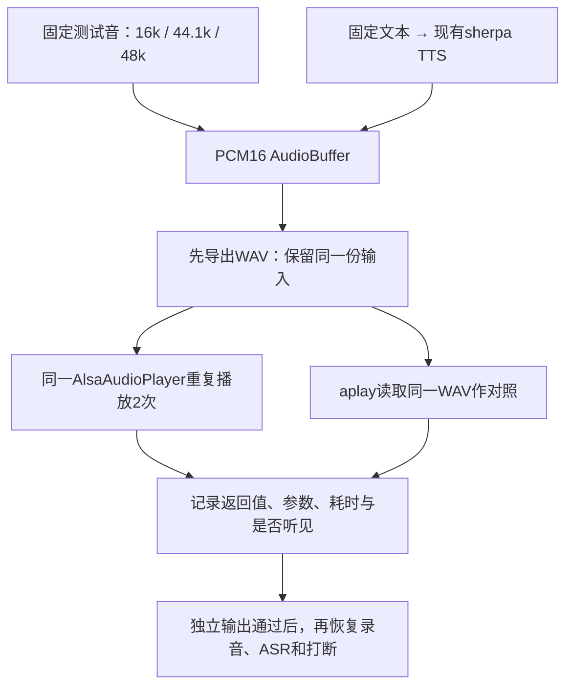

# 板端下一步：独立TTS与ALSA播放验收

更新：2026-11-10。使用者已确认真实IIO文字Agent调用正常。接下来先恢复声音输出；本页命令由使用者在WSL/板端手动执行，智能体没有远程启动声卡测试。

## 1. 为什么先拆出输出链路

此前完整语音会话出现过：

```text
failed to apply playback parameters: Invalid argument
```

这是早期日志；后续用户提供的unmatched rate symmetry已明确本次16k采集/44.1k播放冲突，修订见[专门说明](rk3588-duplex-fix.md)。先固定输入、关闭录音和打断路径，再用同一份WAV对照，可以缩小范围。

新增入口复用现有AlsaAudioPlayer和board_voice_assistant的TTS配置，不修改播放参数协商、buffer策略或stop并发行为。



tone是1秒440Hz单声道提示音，幅度为PCM满幅的10%。tts只合成一次，后续重复播放同一PCM；不加载ASR、VAD、Agent、检索或RKLLM，也不需要Python运行时服务。

## 2. 本次独立包与传输

遇到本文记录的采样率对称冲突时，先安装[最新小更新包](rk3588-duplex-fix.md)提供项目ALSA profile。下面14MB包为早期独立探针资产，不能替代该配置更新。

**旧部署目录已删除时，请先用[完整恢复包](rk3588-deployment.md)。本节的小包不含模型，适用于已有完整资产的部署。完整包自带run-audio-check.sh，可按包内DEPLOY.md继续同样的分层输出验收。**

标签：`audio-output-20261110-xc9gdpdj`。包约14 MB，不含模型；包含程序、ARM运行库、参考conf、构建清单及校验表。使用现有部署根目录的TTS资产，不覆盖现有board_voice_assistant。

归档SHA256：`3f17f12de9d07e1c28b9732128a61920b5ab198152b53e24b82a9c83093b845e`。

在**WSL项目根目录**传输：

```bash
sha256sum .cache/audio-output-20261110-xc9gdpdj.tar.gz
ssh root@192.168.10.100 \
  'cat > /tmp/audio-output-20261110-xc9gdpdj.tar.gz' \
  < .cache/audio-output-20261110-xc9gdpdj.tar.gz
```

在**板端**解压到新目录；目录已存在时不要覆盖，先确认是否已完成本步骤：

```sh
mkdir -p /userdata/edge_voice_audio
AUDIO=/userdata/edge_voice_audio/audio-output-20261110-xc9gdpdj
if mkdir "$AUDIO"; then
    tar -xzf /tmp/audio-output-20261110-xc9gdpdj.tar.gz -C "$AUDIO"
fi
cd "$AUDIO"
sha256sum -c bundle.sha256
export LD_LIBRARY_PATH="$AUDIO/lib${LD_LIBRARY_PATH:+:$LD_LIBRARY_PATH}"
ldd "$AUDIO/bin/audio_output_check"
```

校验应全部通过，ldd不得有not found。板端系统提供glibc、动态加载器和ALSA设备/配置；本包不携带或修改系统声卡配置。libzmq是core传递的库依赖，无需启动ZeroMQ服务。

.cache被Git忽略，包只属于当前工作区；新克隆需按第7节构建并准备匹配ARM依赖。

## 3. 固定工作目录，保留日志

先退出正在运行的语音主程序/其他播放程序，避免它们占用同一设备。不要为此卸载已正常工作的DHT11驱动。

以下命令继续在同一板端shell执行：

```sh
cd /userdata/EdgeVoiceRAG
CONF="$AUDIO/config/board_rk3588.conf"
export ALSA_CONFIG_PATH="$PWD/config/alsa-rk3588.conf"
PCM=edge_voice_16k
RUN=$(mktemp -d /userdata/edge_voice_audio/output-run-XXXXXX)
echo "$RUN"

cat /proc/asound/cards > "$RUN/cards.txt"
aplay -l > "$RUN/aplay-devices.txt" 2>&1
amixer -c rockchipes8388 scontents > "$RUN/mixer-before.txt" 2>&1
cat "$RUN/cards.txt"

sha256sum models/tts/vits-melo-tts-zh_en/model.int8.onnx \
  models/tts/vits-melo-tts-zh_en/lexicon.txt \
  models/tts/vits-melo-tts-zh_en/tokens.txt \
  models/tts/vits-melo-tts-zh_en/date.fst \
  models/tts/vits-melo-tts-zh_en/number.fst > "$RUN/tts-assets.sha256"
cat "$RUN/tts-assets.sha256"
```

RUN是每次新建的日志目录，请保留其路径。包中参考conf的模型路径相对于**当前工作目录**；因此从/userdata/EdgeVoiceRAG运行。若部署路径不同，进入实际根目录，或复制参考conf到RUN并改为真实模型路径，再将CONF指向新副本。

本次Host模型SHA256为 `f085f5079e05f039b800aeb542f5253c26a303211b0c6465d0d9387977855a63`；五个资产的期望指纹均在build-manifest.json。板端若有不同版本，保留实际指纹，并以audio_check_audio记录为准，不套用Host格式或耗时。

## 4. 第一步：三种采样率的固定测试音

```sh
for RATE in 16000 44100 48000; do
    "$AUDIO/bin/audio_output_check" --config "$CONF" \
      --device "$PCM" --mode tone --sample-rate "$RATE" --repeat 2 \
      --output-wav "$RUN/tone-$RATE.wav" > "$RUN/tone-$RATE.log" 2>&1
    RC=$?
    echo "tone rate=$RATE rc=$RC"
    cat "$RUN/tone-$RATE.log"
done
```

每种采样率应听到两次短提示音，出现两条ok=true的audio_check_playback，进程rc=0。记录**每种采样率是否听到声音**；程序返回成功本身不能证明扬声器发声。

默认请求period为1024帧，与当前主程序一致。暂时不要同时更改采样率、周期、设备和混音音量；如果失败，先保留原日志。已有WAV不会被覆盖，重新测请新建RUN。

## 5. 第二步：真实TTS模型 → 重复播放

```sh
"$AUDIO/bin/audio_output_check" --config "$CONF" --device "$PCM" \
  --mode tts --text "语音输出测试，温湿度设备已经接入。" --repeat 2 \
  --output-wav "$RUN/tts.wav" > "$RUN/tts.log" 2>&1
RC=$?
echo "tts rc=$RC"
cat "$RUN/tts.log"
```

预期听到同一句话两次，且两条播放结果ok=true。audio_check_audio报告源音频采样率、声道、帧数和时长；本次Host相同资产得到44100Hz单声道PCM16，板端以实际输出为准。tts模式不能指定--sample-rate，它保持模型实际输出格式。

tts_load_ms是后端构造/模型加载时间，tts_synthesis_ms是本次整句合成时间；这里没有流式分句与录音，不应当成完整会话首播指标。

## 6. 第三步：同一WAV用aplay对照

即使程序播放失败，只要日志已有audio_check_wav，WAV就已在打开声卡前保存，可继续执行：

```sh
aplay -D "$PCM" -v "$RUN/tts.wav" > "$RUN/aplay-tts.log" 2>&1
RC=$?
echo "aplay tts rc=$RC"
cat "$RUN/aplay-tts.log"
```

TTS尚未生成WAV时，先用已生成的tone-16000.wav替代。aplay使用自己的参数协商方式；同WAV结果不同能提供线索，不能单凭它断言具体某个ALSA参数有错。

| 实测组合 | 下一步如何定位 |
| --- | --- |
| tone、TTS及aplay均成功且可听 | 独立输出成立；回到完整语音的录音/VAD/ASR，再检查Agent回答与播放、打断 |
| 16k tone成功，44.1k或TTS播放失败 | 保留sample_rate/channels/period请求、ALSA错误和aplay -v；核对格式/周期/底层设备约束 |
| 程序失败，aplay同WAV成功 | 检查播放器参数提交/状态恢复差异；先不修改模型或Agent |
| 程序和aplay都失败 | 先查设备名、占用、系统ALSA配置与驱动错误 |
| 两者都返回成功但无声音 | 检查接线、输出口、功放/静音和Mixer路由；日志成功不等于可听 |
| 独立输出通过，只有完整会话失败 | 再检查录放并发、stop与configure的时序和打断；并发竞争目前只是候选原因 |

新板端日志明确出现16000/44100的ASoC采样率对称冲突，现使用项目edge_voice_16k固定slave.rate=16000；TTS源格式仍保留44100。请加载项目ALSA_CONFIG_PATH后使用同一PCM对照，修订与小更新包见[采样率冲突修复](rk3588-duplex-fix.md)。参见[ALSA官方PCM插件说明](https://www.alsa-project.org/alsa-doc/alsa-lib/pcm_plugins.html)。

请回传：三种tone的rc和是否听到、tts.log、TTS是否两次可听、aplay-tts.log及是否可听；失败时附最近相关dmesg。无需重复已经确认正常的DHT11/文字Agent测试。输出通过后，按[主线手动语音步骤](rk3588-performance.md)继续，避免直接把一次播出扩展为长期稳定或打断通过。

## 7. 构建与CLI速查

Host仅检查输出装配，使用null空设备，不会发声：

```bash
cmake -S . -B build-audio-check -DCMAKE_BUILD_TYPE=Debug \
  -DBUILD_TESTING=ON -DEDGE_ENABLE_ALSA=ON \
  -DEDGE_ENABLE_BGE_EMBEDDER=OFF -DEDGE_ENABLE_RKLLM=OFF \
  -DEDGE_ENABLE_SHERPA_ASR=OFF -DEDGE_ENABLE_SHERPA_TTS=OFF \
  -DEDGE_ENABLE_SHERPA_VAD=OFF -DEDGE_ENABLE_ASAN=OFF -DEDGE_ENABLE_UBSAN=OFF
cmake --build build-audio-check --target audio_output_check alsa_audio_backend_tests -j4
ctest --test-dir build-audio-check -R '^(alsa_audio_backend_tests|audio_output_check_smoke)$' --output-on-failure
```

ARM独立输出目标只需ALSA/TTS。按[开发文档](development.md)准备工具链和匹配sherpa头文件/库路径：

```bash
cmake -S . -B .cache/build-rk3588-audio \
  -DCMAKE_TOOLCHAIN_FILE=cmake/toolchains/rk3588-buildroot.cmake \
  -DCMAKE_BUILD_TYPE=Release -DBUILD_TESTING=OFF \
  -DEDGE_ENABLE_ALSA=ON -DEDGE_ENABLE_SHERPA_TTS=ON \
  -DEDGE_ENABLE_BGE_EMBEDDER=OFF -DEDGE_ENABLE_RKLLM=OFF \
  -DEDGE_ENABLE_SHERPA_ASR=OFF -DEDGE_ENABLE_SHERPA_VAD=OFF \
  -DEDGE_ENABLE_ASAN=OFF -DEDGE_ENABLE_UBSAN=OFF
cmake --build .cache/build-rk3588-audio --target audio_output_check -j4
```

| 参数 | 默认值 / 约束 |
| --- | --- |
| --config PATH | config/board_rk3588.conf；复用BoardAppConfig格式与校验 |
| --device PCM | 缺省使用conf.playback_device |
| --mode tone或tts | 默认tone；tts要求编译开关EDGE_ENABLE_SHERPA_TTS=ON |
| --sample-rate HZ | tone专用，默认16000，范围8000～192000；设备不一定支持所有值 |
| --text TEXT | tts专用，默认上述中文句子；最多4096个UTF-8字节 |
| --period-frames N | 默认1024，范围1～65536；是请求值，不是协商实值 |
| --repeat N | 默认2，范围1～10；同一PCM/播放器重复提交 |
| --output-wav NEW_PATH | 可选；父目录已存在、文件尚不存在；播放前写入 |
| --help / -h | 显示用法，不加载配置、声卡或模型 |

退出0：所有play返回ok；1：运行错误；2：参数错误。输出字段见[协议说明](protocols.md#独立音频输出cli与jsonl-v1)。

本地验证、构建与包指纹见[2026-11-10实验记录](experiments/2026-11-10-audio-output-check.md)。已获得用户板端采样率冲突日志；现以项目plug配置固定硬件端16k，C++播放器协商/取消代码未改动，修复后的板端结果待用户确认。
