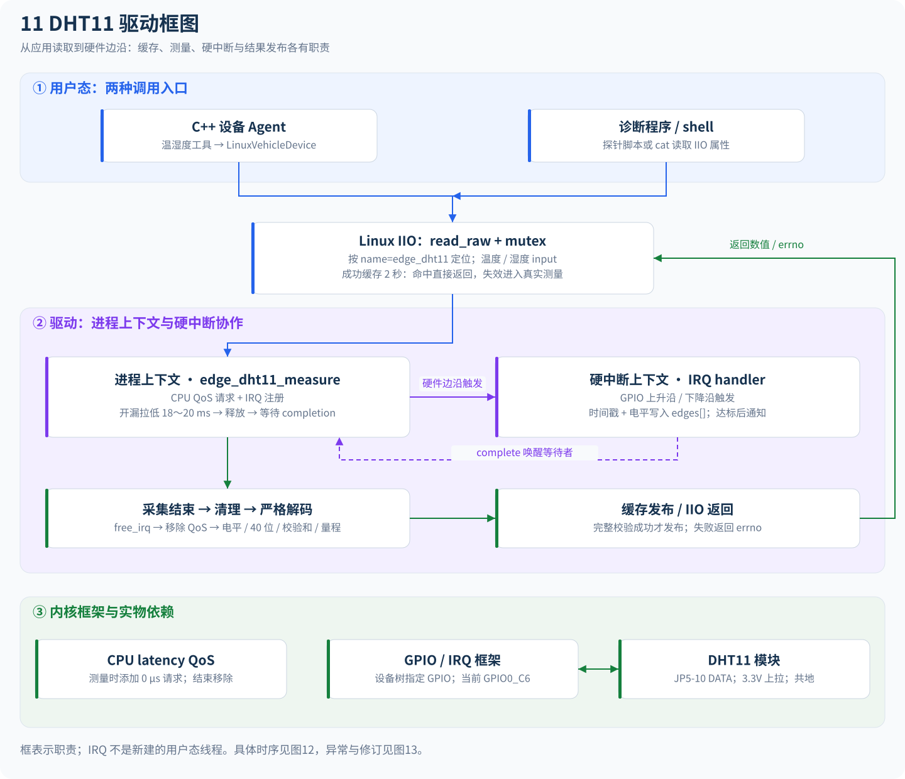
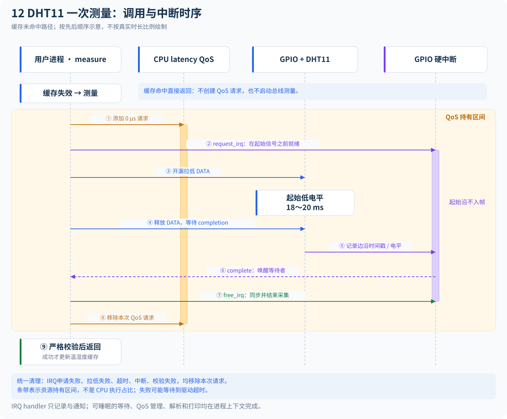
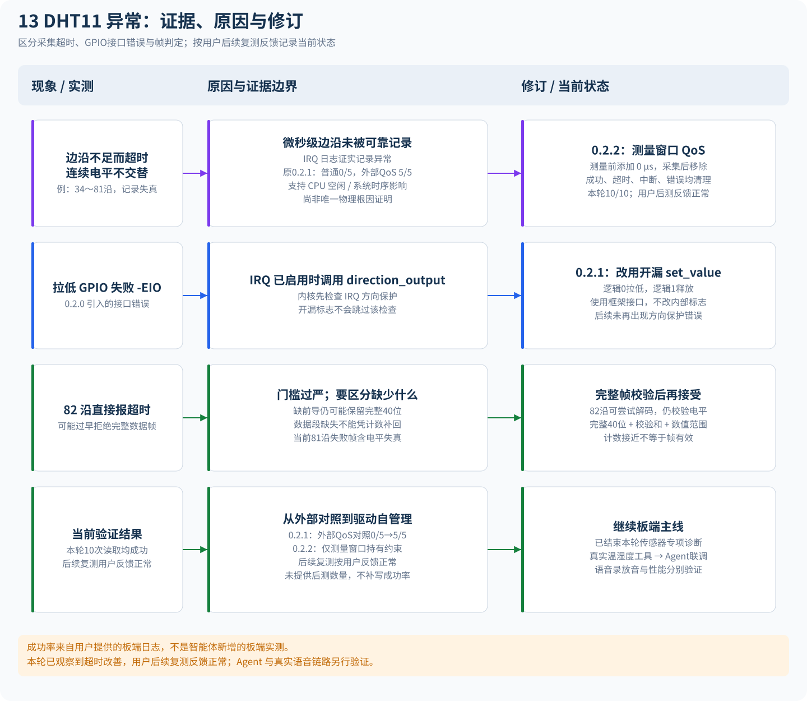

# DHT11 驱动框图、调用时序与异常复盘

更新：2026-11-10。当前驱动版本为0.2.2-window-qos。本文解释仓库中的实际实现；接线和加载命令见[DHT11硬件说明](hardware-dht11.md)。

本轮板端读取为10/10成功，用户随后补充“后续测试没有问题”。按用户要求结束首条读数的专项追查，原始值保留在[实验记录](experiments/2026-11-10-dht11-window-qos-10read.md)，不再作为当前开发的阻塞项。这里的图不表示Agent/真实语音链路已经完成验收。

## 1. 驱动分层框图

[打开可缩放SVG](diagrams/11-dht11-driver-architecture.svg)

上层设备工具通过LinuxVehicleDevice读取IIO温湿度属性；shell和诊断探针也通过相同属性访问。IIO回调运行在发起读取的进程上下文，驱动没有为每次读取创建一个新线程，也没有在加载后持续后台轮询传感器。

| 模块 / 接口 | 职责 |
| --- | --- |
| 设备树节点 | compatible匹配alientek,edge-dht11，data-gpios指定GPIO；当前SDK使用GPIO0_C6，接JP5-10 |
| edge_dht11_probe | 取得开漏GPIO，检查其不可睡眠，映射IRQ，初始化mutex/completion，注册name=edge_dht11的IIO设备 |
| edge_dht11_read_raw | 串行化同一设备的读取，调用更新逻辑，返回所选通道的processed值 |
| edge_dht11_update | 成功缓存2秒；未建立或过期才触发真实测量 |
| edge_dht11_measure | 管理QoS和IRQ，发送起始信号，等待采集，清理资源，严格解码，成功后发布缓存 |
| edge_dht11_irq_handler | 硬中断中记录处理时刻的时间戳与GPIO电平，写入有界edges数组，达标后complete通知 |
| edge_dht11_decode_frame / decode_at_offset | 尝试对齐，检查上升/下降电平与时间，解出40位，验证校验和与数值范围 |
| LinuxVehicleDevice | 按IIO name查找设备，将毫摄氏度/千分之一%RH除以1000后供Agent工具使用 |

实现入口：[驱动](../kernel_modules/edge_dht11/edge_dht11.c)、[常量与边沿结构](../kernel_modules/edge_dht11/edge_dht11.h)、[共享帧解析器](../kernel_modules/edge_dht11/edge_dht11_frame.h)、[C++设备适配](../src/devices/linux_vehicle_device.cpp)。

温度与湿度是两个属性，但一次测量同时解码两者。紧接读取通常命中同一帧缓存，不能把两次属性读取都算成独立传感器采样。测量失败不会发布部分新结果，也不会把旧值伪装成这次读取成功。

## 2. 一次测量如何跨上下文完成

[打开可缩放SVG](diagrams/12-dht11-measurement-timing.svg)

正常流程如下：

1. 缓存失效后，测量函数添加0µs CPU latency QoS请求。
2. 总线空闲时完成IRQ注册；Rockchip配置触发方式可能切换GPIO方向，因此注册放在起始拉低之前。
3. 开漏逻辑0拉低DATA，保持18～20ms。期间的主机起始沿不作为数据帧记录。
4. 开启本轮采集后用开漏逻辑1释放DATA，等待传感器响应；最初的主机释放高电平不入帧，从响应下降沿开始。
5. 双边沿触发硬中断，记录时间戳和当前电平。达到采集目标后complete唤醒等待者。
6. 进程调用free_irq同步在途handler，随后移除QoS请求，再打印、解析和返回。
7. 只有40位数据、校验和与范围均通过才更新温湿度和缓存时间。

通常以83沿为采集目标，最后还可能多记录尾部边沿，因此成功日志出现84沿并不自动表示错误。82沿可能仍包含完整数据，会在等待结束后尝试解码；数量接近目标本身并不保证帧有效。

mutex负责同一设备读取不重叠；completion用于IRQ通知等待进程。handler不做睡眠等待和逐沿打印，free_irq之后才读取完整数组与打印明细。IRQ不是项目语音图中T0～T4中的一个新用户态线程。

### QoS为何只在窗口内持有

CPU空闲状态的退出延迟可能与DHT11的微秒脉宽处于同一量级。本机用户日志中的cpu-sleep标称退出延迟为220µs，而数据高脉冲约25µs或70µs；如果处理过晚，handler读取到的可能已是后续变化后的电平。

cpu_latency_qos_add_request(0)提出全局CPU延迟要求，影响可选空闲状态；它不锁CPU频率，也不提供硬实时保证。用户态/dev/cpu_dma_latency是同一类CPU延迟QoS接口名称，不表示本驱动进行了DMA数据搬运。[Linux PM QoS说明](https://docs.kernel.org/power/pm_qos_interface.html)、[CPU idle说明](https://docs.kernel.org/admin-guide/pm/cpuidle.html)

当前请求只在真实测量期间存在：成功采集后立即释放；IRQ申请失败、拉低失败、超时、中断和校验失败等出口也清理。缓存命中不创建新请求，避免持续占用约束。错误情况下可能持有到驱动超时和清理结束。

## 3. 之前为何异常，分别如何处理

[打开可缩放SVG](diagrams/13-dht11-faults-and-fixes.svg)

### 3.1 超时、边沿不足与连续相同电平

早期日志包含34～82沿超时；两帧失败明细出现连续previous_level=1等记录。对于正常交替的物理脉冲，如果IRQ响应或读取电平不及时，软件可能错过中间变化，形成高→高等记录。GPIO IRQ的处理时刻与真实电气跳变时刻不能直接等同。

软件日志确认了记录异常，但无法单独排除电气噪声。我们据此做了有针对性的CPU延迟A/B，而不是通过补位或放宽校验让损坏帧通过：

| 对照阶段 | 已提供的板端结果 | 能说明什么 |
| --- | --- | --- |
| 0.2.1普通模式 | 0/5成功 | 本组采样不稳定 |
| 0.2.1外部0µs约束 | 5/5成功，约24.6ms | 支持CPU空闲/系统时序影响采集的假设 |
| 0.2.2驱动窗口请求 | 10/10读取成功 | 本轮无需外部约束即可避免超时 |
| 用户后续复测 | 用户反馈没有问题，未提供数量 | 按用户反馈推进，不补写额外成功率 |

因此0.2.2将请求内置到测量窗口。组前后的频率快照不是连续trace，样本也有限，这些结果不用于宣称某个空闲状态是唯一根因或已完成长期可靠性统计。证据见[A/B与窗口修订](experiments/2026-11-09-dht11-qos-window.md)、[后续验证](experiments/2026-11-10-dht11-window-qos-10read.md)。

### 3.2 为什么0.2.0又出现了-EIO

0.2.0试图提前注册IRQ以减少释放后的注册窗口，但之后调用gpiod_direction_output拉低。内核先检查GPIO是否绑定已启用IRQ，命中就返回-EIO，开漏标志不会让这个方向API跳过检查。这是该修订引入的接口错误。

0.2.1改为对已配置开漏描述符调用gpiod_set_value：逻辑0拉低，逻辑1释放，由外部3.3V上拉形成高电平。没有修改内核内部标志或GPIO控制器源码。后续日志未再出现这条方向保护错误。[接口修订记录](experiments/2026-11-09-dht11-od-value.md)

同为-EIO，要看错误发生阶段：failed to drive data GPIO low是启动失败，failed to decode DHT11 frame是数据校验阶段失败，不能当作同一故障。

### 3.3 为什么82沿可以尝试，81沿损坏帧却没有直接放行

完整数据是40位。缺少一个前导边沿时，82条记录有可能仍含完整40位，因此直接按不足83拒绝过严；当前与[Linux参考驱动](https://github.com/torvalds/linux/blob/v6.1/drivers/iio/humidity/dht11.c)类似，在82沿时仍尝试完整帧解码。

实际失败的81沿日志存在连续相同电平，不能仅凭数量假设只是缺少前导。当前不会补造位，仍要求电平、完整40位、校验和及范围通过。修订的目的是接受可证明完整的帧，不是降低数据正确性要求。

### 3.4 当前阶段结果

0.2.2已在用户本轮10次读取中全部返回成功；用户补充后续测试没有问题。首条历史读数按用户要求不再专项追查，原始值保持可追溯。

接下来回到板端主线：核对LinuxVehicleDevice读取真实温湿度、Agent工具返回值，再分别验收语音录放音与性能。此前的ALSA问题不因传感器通过而自动成为已解决事项。

## 4. 测试与维护入口

| 验证 | 覆盖范围 | 不能代替的验证 |
| --- | --- | --- |
| 10组共享帧解析用例 | 完整82/83沿、截断、坏校验、电平/时间/范围边界、真实成功帧回放 | 物理线路与真实IRQ时序 |
| 采集流程普通 / ASan+UBSan，各9类 | 正常、重复、失败、中断、校验、缓存及QoS/IRQ清理 | probe、真实PM QoS及控制器行为 |
| 延迟探针7项标准库测试 | 按名称定位、请求关闭、失败计数及对照顺序 | 板端A/B和传感器准确度 |
| 用户板端日志 | 指定版本、指定次数的实际行为 | 未执行的长期稳定性和Agent/语音联调 |

命令见[模块README](../kernel_modules/edge_dht11/README.md)和[测试手册](testing-guide.md)。图源为[render_flowcharts.py](diagrams/render_flowcharts.py)，在项目根目录运行 `python3 docs/diagrams/render_flowcharts.py` 可离线重建全部SVG。
