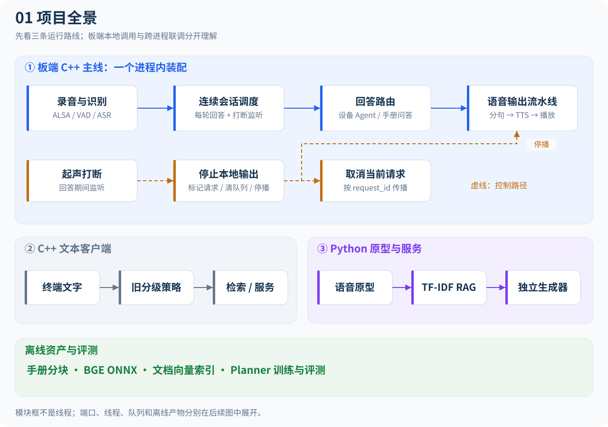
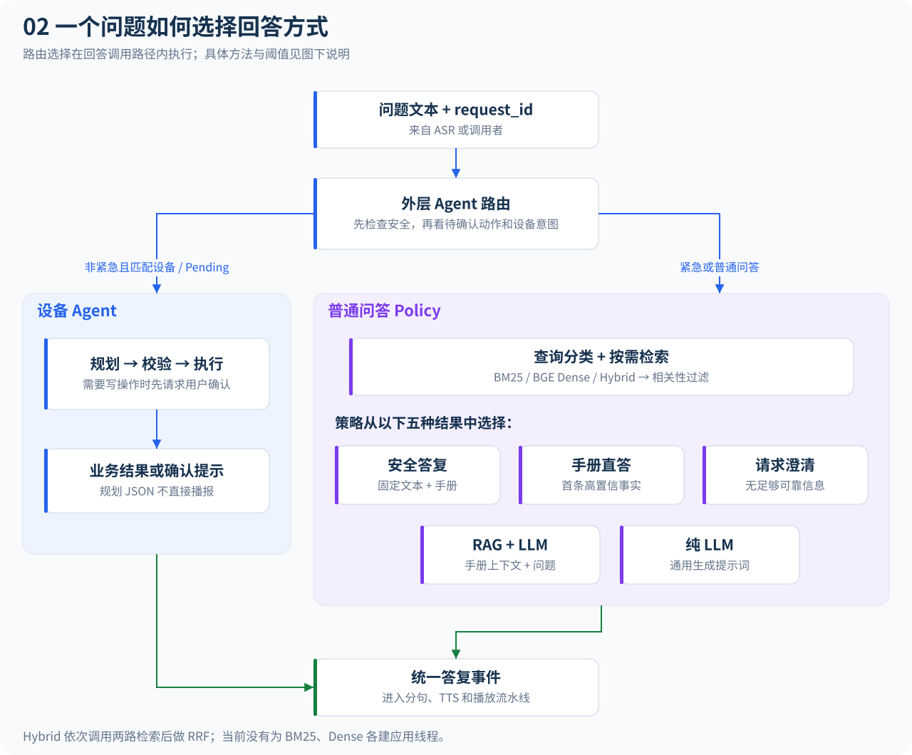
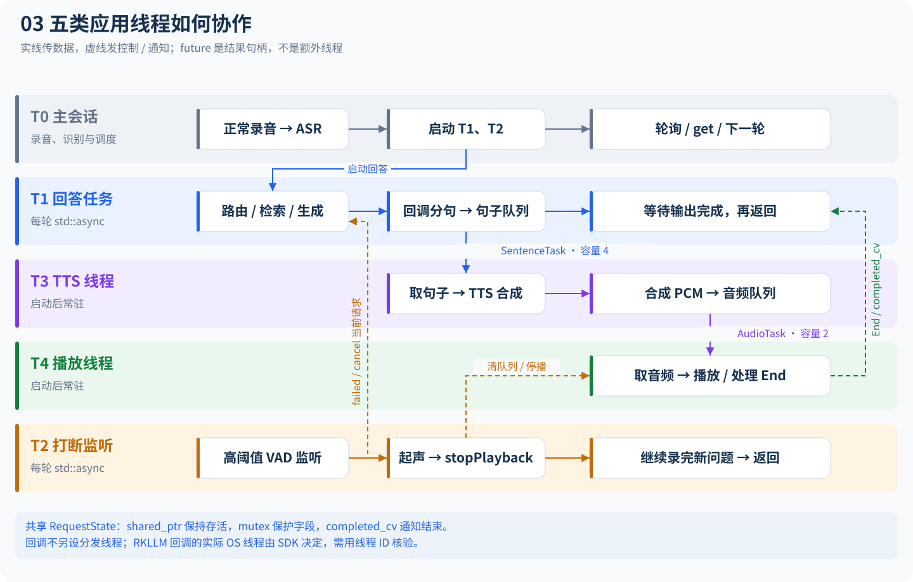
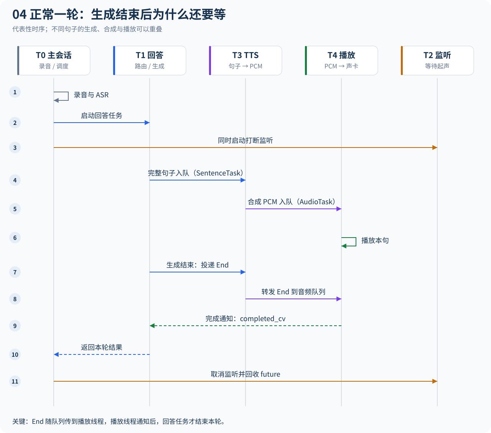
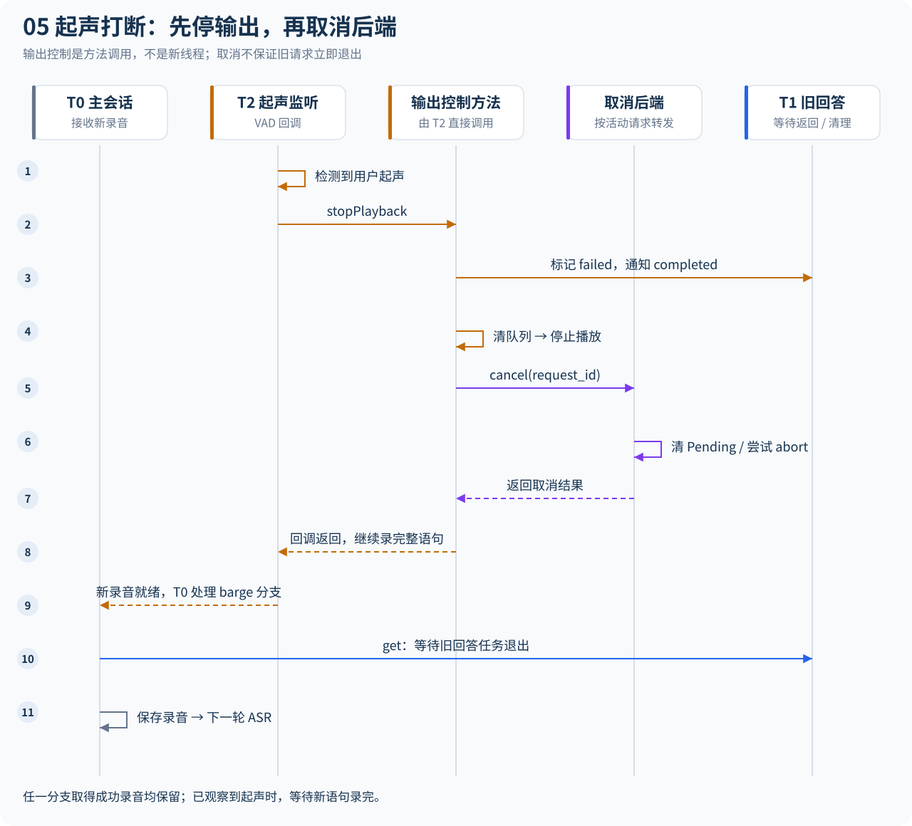
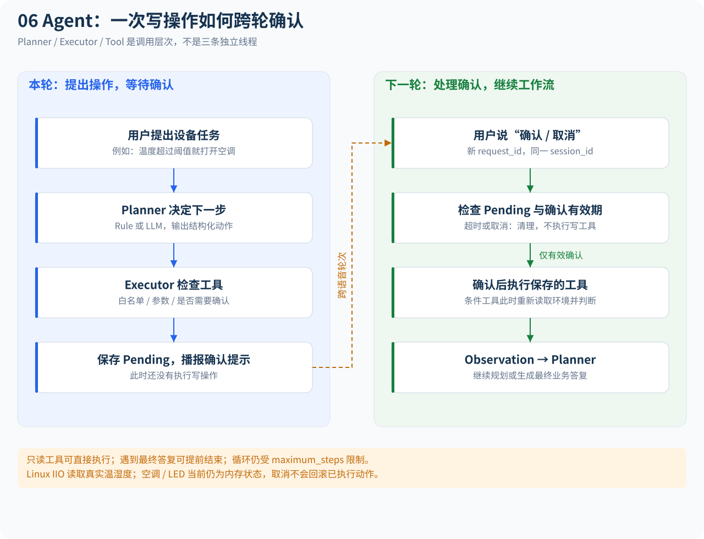
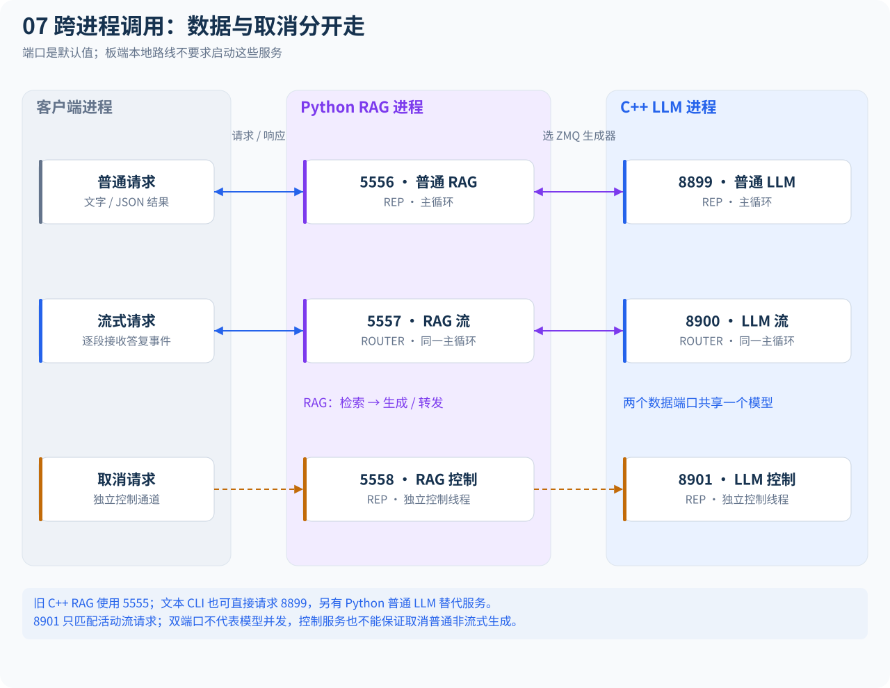
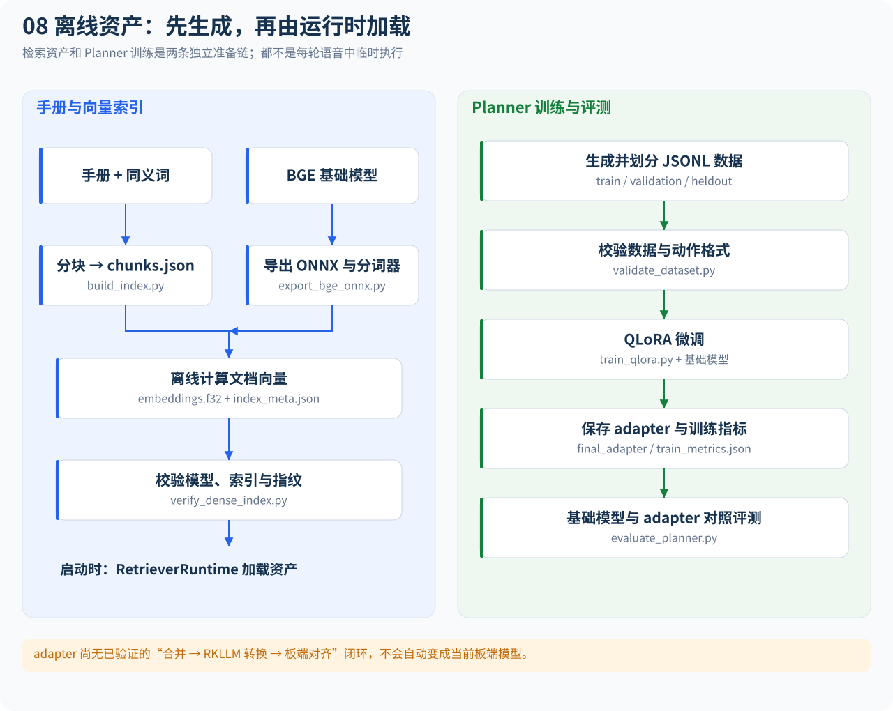

# 项目调用流程与线程协作图解

核对日期：2026-11-08。本文描述**当前实现**。点击每张图下的链接可以打开可缩放的 SVG 大图。

**当前学习与开发范围：板端C++主线。** 建议先看第1张中的板端路线A，再看第3张线程图、第4/5张时序图，最后对照第2/6张理解路由与Agent。第7节ZeroMQ/Python跨进程路线暂缓，保留作参考；第8节的离线资产准备按板端需要查阅。

| 图 | 解决的问题 |
| --- | --- |
| [1. 项目全景](#overview) | 板端、本地文本、Python服务、离线工具如何关联 |
| [2. 路由与检索](#routing) | 一个问题为什么进入Agent、手册直答或LLM |
| [3. 线程泳道](#threads) | 哪些工作同线程执行，哪些通过队列跨线程 |
| [4. 正常完成时序](#normal) | 从录音到播报完成，End标记和CV如何配合 |
| [5. 起声打断时序](#interrupt) | 清队列、停播、取消生成和下一轮录音如何衔接 |
| [6. Agent跨轮工作流](#agent) | 工具调用、用户确认、Observation如何串起来 |
| [7. 进程与ZeroMQ](#network) | 跨进程调用及取消服务在哪个线程处理 |
| [8. 离线资产](#offline) | 手册、ONNX、向量、QLoRA训练与运行时的关系 |

## 图例与阅读约定

- 卡片表示方法、模块、队列或资产，名称与副标题说明其职责；**模块卡片本身不代表一个线程**。
- 线程泳道从上往下按角色排列；时序图从上往下表示先后，箭头两端的列说明谁调用谁。
- 蓝色表示回答路径，紫色表示TTS，绿色表示播放，橙色表示打断/取消，灰色表示主会话；颜色与文字标签共同标识角色。
- 实线按标注表达调用或数据传递，虚线表示取消、通知、可选关联或补充说明。
- T0～T4是本文为解释而命名的应用线程角色，不是代码中设置的线程名称或固定OS线程ID。
- SDK内部线程、ZeroMQ I/O线程、声卡驱动和内核IRQ不计入这五类应用线程；不能据此声称进程只有五个OS线程。

<a id="overview"></a>

## 1. 项目全景：三条运行路线与离线工具



[打开 SVG 大图](diagrams/01-project-overview.svg)

**路线A是当前主线**：板端入口在同一个C++进程内装配语音、Retriever、LLM、设备Agent，不要求先启动PythonRagServer或llm_server。进程内方法调用与网络调用应分开理解。

路线B的文本CLI使用旧 `MultiLevelResponseSystem`：先查进程内缓存，未命中再分类，按RagOnly/LlmOnly/Hybrid调用 `EdgeResponseBackend`。local使用本地BM25，zmq/python_zmq使用远程RAG；需要生成时请求独立LLM服务。它没有板端的TTS/播放队列，不能把路线A的线程图直接套用到它。

路线C是Python语音原型和跨进程联调。Python语音助手消费RAG事件后逐句合成并播放，其实现与C++双队列流水线不同，详见第7节。

其他入口：

- `agent_demo`：Rule Planner + Mock设备，终端交互，不经过ASR/TTS。
- `sherpa_asr_demo`：单独验证ASR，不启动完整连续会话。
- `VoiceInputPipeline::processOnce`：可复用的同步单轮“录音→ASR→VoiceAssistant”接口；板端连续入口实际使用ContinuousVoiceSession，未调用该接口。
- `retrieval_benchmark`、`voice_performance_summary`：离线测量/汇总工具，不是主链路后台服务。

<a id="routing"></a>

## 2. 一轮问题的路由与检索调用



[打开 SVG 大图](diagrams/02-routing-and-retrieval.svg)

主要代码：[外层Agent路由](../src/agent/agent_routing_answer_backend.cpp)、[问答后端](../src/response/policy_routing_answer_backend.cpp)、[响应策略](../src/response/response_policy.cpp)、[检索装配](../src/retrieval/retriever_runtime.cpp)。

外层路由先检查安全类别。非紧急情况下，只要有待确认动作，或设备意图命中，就交给Agent；紧急问题进入普通问答的Safety路径，若此前有Pending则先尝试清除，避免旧操作被下一声“确认”触发。

Policy的实际步骤：

1. 分类后调用 `decideWithoutRetrieval`；Creative直接走LlmOnly，其余先检索。
2. 按结果调用 `decideWithRetrieval`。Emergency走Safety；Factual且首条高置信走DirectRag；其余有结果走RagLlm。
3. 无结果时，Complex/Creative走LlmOnly，其他类别请求澄清。
4. Safety/DirectRag/Clarification直接产生答复事件；RagLlm/LlmOnly调用 `generateStream`。

因此Safety当前也可能先查手册，回答由固定安全文本和可用手册内容构造；不能画成“发现紧急→直接调用LLM”。

检索器在启动时加载：

- BM25调用分词、词项统计与排序；Dense调用BGE编码、内存向量搜索及文档映射。
- Hybrid依次调用BM25、Dense，再按chunk_id做加权RRF。**当前没有为双路检索各开一个应用线程。**
- 相关性过滤保留原始sparse或dense分数达标的候选；直答策略再使用独立的更高门槛。
- `DocumentChunk.text` 提供手册事实；aliases/retrieval_text辅助召回，不作为额外事实。
- Agent的LLM Planner先得到完整工具JSON再执行工具，最后把业务答复封装为Chunk；不会把规划JSON当作播报token直接送给TTS。

<a id="threads"></a>

## 3. 板端线程泳道：真正跨线程的边界



[打开 SVG 大图](diagrams/03-thread-lanes.svg)

| 角色 | 创建/运行位置 | 持续时间与工作 |
| --- | --- | --- |
| T0 主会话 | main调用 `ContinuousVoiceSession::run` | 正常录音、ASR、启动每轮任务、轮询/回收future、发事件、下一轮 |
| T1 回答任务 | 每轮 `std::async(std::launch::async, ...)` | `processText`，调用路由/检索/生成，结束后等待输出流水线完成 |
| T2 打断任务 | 每轮另一处 `std::async(std::launch::async, ...)` | 高阈值VAD；起声回调直接调用stopPlayback，再继续收集完整语句 |
| T3 TTS线程 | `VoiceAssistant::start` 创建std::thread | 常驻，消费SentenceTask，合成PCM，投递AudioTask |
| T4 播放线程 | 同上 | 常驻，消费AudioTask，播放PCM，处理End并通知完成 |

回答期间通常同时存在这五个应用线程角色；录音/ASR阶段并不是每次都保持两个async任务运行。future是等待/取得结果的对象，**不是额外的一条线程**。

### 3.1 回调在哪个线程执行

ALSA `capture` 在调用它的线程内读PCM并直接调用chunk handler；VAD在这个handler里直接调用起声回调。因此普通VAD处理位于T0，打断VAD和其起声回调位于T2，没有另设一个“VAD回调线程”。

普通同步后端/Mock的答复handler沿T1调用栈执行；`StreamingSentenceBuffer` 也在该回调路径使用。RKLLM适配器把SDK回调直接向上转发，**仓库没有明确固定SDK回调的OS线程身份**。图中独立标注了回调上下文，不能单凭框的位置断言所有RKLLM handler都在T1；需要线程ID日志核验SDK行为。

ASR、TTS、BGE的底层Runtime可能各自有内部推理线程池，配置中的num_threads影响这些内部执行，并不等于新建同名的项目调度线程。

### 3.2 队列、背压与共享状态

| 边界 | 数据/对象 | 同步行为 |
| --- | --- | --- |
| 回答回调→T3 | `SentenceTask{text,state,end_of_request}`，默认容量4 | push满时等待；pop空时等待；提供背压 |
| T3→T4 | `AudioTask{audio,state,end_of_request}`，默认容量2 | 同上；PCM使用移动语义转移 |
| T1/T2/T3/T4 | `shared_ptr<RequestState>` | shared_ptr维持寿命；字段靠state.mutex保护 |
| T4/T2→T1 | `completed` + `completed_cv` | 锁内置位，再notify；wait时释放锁并用谓词检查 |
| T0→T1/T2 | 两个future | wait_for检查是否ready，get取得结果并可能等待 |

队列满的影响可以沿上游传播：音频队列满让TTS等播放；句子队列随后可能满，让生成回调等待。由此可以看到“生成首token很快”仍不一定意味着整轮很快，后续诊断应测队列等待与峰值深度。

`StreamingSentenceBuffer` 没有锁；它被设计成一个请求内串行使用的缓冲器。不要将多个请求/并发回调任意接入同一个实例。

<a id="normal"></a>

## 4. 正常完成：为什么生成结束后还要等



[打开 SVG 大图](diagrams/04-normal-turn.svg)

这是正常成功路径的代表性时序。队列投递与消费合并到箭头标签中；不同句子的生成、合成和播放可以重叠，图中纵向排列不代表整轮串行。

关键是两类“结束”：

- **后端生成结束**：query返回，T1补齐分句器中没有终止标点的剩余文本，然后投递句子End。
- **本轮输出完成**：T3把End转到音频队列；T4消费前面的音频后收到End，调用completeState通知T1。

因此 `VoiceAssistant::processText` 是一个等待整轮输出的阻塞方法。把它放入T1之后，T0才可以同时调度T2监听打断。不能把它画成“调用query后立刻返回结果”。

如果后端没有发任何Chunk，processText会使用完整answer补走分句流程。若入队失败等异常导致无法正常传递End，会走失败/完成兜底；图中的End链不是所有错误分支的唯一出口。

T0在answer_future先ready时先get回答；尚未观察到起声时取消监听，已经起声则等待新语句录完。随后get监听结果：成功录音保存到pending_capture，按一次中断计数并进入下一轮；没有成功录音才继续正常完成路径、发AnswerCompleted。板端printEvent在AnswerCompleted中输出ANSWER、POLICY、PERF_JSON；统计时需区分正常完成与中断轮次。

<a id="interrupt"></a>

## 5. 起声打断：跨线程控制链



[打开 SVG 大图](diagrams/05-barge-in.svg)

主要代码：[打断监听与future分支](../src/voice/continuous_voice_session.cpp)、[stopPlayback与interruptActiveRequest](../src/voice/voice_assistant.cpp)、[RKLLM cancel](../src/inference/rkllm_backend.cpp)。

实际执行顺序是：

1. T2的VAD发现起声，atomic exchange防止同一轮回调重复执行。
2. T2直接调用stopPlayback，复制active_state，按request_id定位请求。
3. 标记failed并置completed、通知CV；清两个队列，调用播放器stop。
4. 再调用取消后端。外层路由根据活动后端转给Policy或Agent，最终可能调用rkllm_abort。
5. 返回后发BargeInDetected，VAD继续收集用户的新问题。
6. T0处理成功的barge_future时先取录音、等待旧回答退出，再保存pending_capture；若answer_future先被处理，也会检查并保留成功的录音结果。
7. 下一轮直接对pending_capture做ASR，无需重新录一次。

必须区分：

- completeState让“等待音频完成”的条件成立，**不保证阻塞中的query或push立刻结束**；取消成功返回也不等于旧任务已经完全退出。
- clear只清排队内容，不终止已经开始的synthesize；TTS返回后再次检查failed，丢弃旧请求音频。播放器stop针对本地输出，不会回滚设备动作。
- stopPlayback包含后端cancel调用，取消可能阻塞。T2要等起声回调返回后才能继续处理后续PCM；源码选择先本地停播再后端取消，但没有另建取消线程。
- 当前T0仍先检查answer_future，但两个分支都会保留取到的成功录音；已经观察到起声时不会因为旧回答结束而取消新语句。取消先于起声被观察到、录音失败等边界仍需结合实际录音器验证，不能把Mock通过扩展为所有硬件时序保证。
- 打断监听覆盖回答生成、合成和播放期间，不只在扬声器已经发声之后才启动。

这些边界已加入受控Host测试，并修复回答先完成时丢弃成功录音的问题；具体场景与通过条件见[C++测试手册](testing-guide.md)，修复前后证据见[2026-11-08记录](experiments/2026-11-08-voice-lifecycle.md)。

### 5.1 会话停止与线程回收

| 操作 | 做了什么 | 与起声打断的区别 |
| --- | --- | --- |
| `barge_recorder.cancelCurrentRecording` | 取消当前采集并尝试唤醒PCM读取 | 录音器仍可供后续轮次使用 |
| `VoiceAssistant.stopPlayback` | 标记本轮失败/完成、清队列、停播、尝试取消生成 | 不关闭常驻队列和工作线程 |
| `ContinuousVoiceSession.stop` | 设置停止标志，stop两个录音器，停止本轮输出 | 结束整个连续会话；ASR返回及识别事件回调后再次检查停止标志 |
| `VoiceAssistant.stop` | 中断输出、close两个队列、join TTS/播放线程 | 队列关闭不可reopen，此后start返回false |

run作用域的ScopeExit负责调用assistant.stop；退出分支还会取消打断录音、停止输出并等待仍有效的future。正常返回或错误返回时，async任务的完成/析构语义也可能影响退出耗时，不能把早退理解为自动“杀线程”。

<a id="agent"></a>

## 6. Agent工作流：工具确认跨语音轮次保存



[打开 SVG 大图](diagrams/06-agent-workflow.svg)

主要代码：[AgentAnswerBackend](../src/agent/agent_answer_backend.cpp)、[AgentExecutor](../src/agent/agent_executor.cpp)、[工具注册表](../src/agent/tool_registry.cpp)、[车辆工具](../src/agent/vehicle_tools.cpp)。

这里的Planner、Executor、Tool不是独立常驻线程；它们在回答任务的调用路径上执行。LLM Planner调用generate取得完整JSON，解析为AgentAction，然后由Executor决定执行或等待确认。

`request_id` 每轮不同，负责追踪/取消；默认 `session_id=board-voice-session` 保持不变，使下一轮“确认”能找到Pending。超时在handlePendingAction中检查，没有后台超时清理线程。

原子条件工具 `set_air_conditioner_if_temperature` 在确认后重新读取温度、比较条件、按需控制并读取状态；避免把确认前读数直接作为后续写入依据。参数由工具具体execute校验，不是执行任意模型文本。

设备边界：

- Mock在内存返回环境与设备状态。
- LinuxVehicleDevice环境读取在工具调用处同步访问IIO sysfs；底层DHT11驱动内部使用GPIO IRQ记录边沿、completion唤醒等待，与T0～T4不是同一类执行上下文。
- 真实温湿度读取不意味着空调/LED已接线。两个设备实现的空调状态目前都仍是内存逻辑。
- executor.cancel清除Pending并尝试planner.cancel；已执行的设备写入不会回滚。

<a id="network"></a>

## 7. 跨进程服务：数据通道与取消通道分离



[打开 SVG 大图](diagrams/07-processes-and-network.svg)

主要代码：[C++ LLM服务入口](../src/apps/llm_server.cpp)、[LLM流服务](../src/transport/llm_stream_service.cpp)、[取消线程](../src/transport/llm_control_server.cpp)、[PythonRagServer](../python/rag/python_rag_server.py)、[Python取消服务](../python/rag/rag_control_server.py)。

| 默认端口 | 数据/控制协议 | 服务上下文 |
| --- | --- | --- |
| 5555 | 旧文本RAG，REQ/REP | C++ rag_server，或最小ZMQ示例；不能同时占同一地址 |
| 5556 | Python普通RAG，REQ/REP | PythonRagServer主循环 |
| 5557 | RAG v1流事件，DEALER/ROUTER | 同一Python主循环 |
| 5558 | cancel / cancel_result，REQ/REP | 独立Python控制线程 |
| 8899 | LLM v1普通请求，REQ/REP | C++ llm_server主循环 |
| 8900 | LLM v1流事件，DEALER/ROUTER | 同一C++主循环，复用同一模型后端 |
| 8901 | cancel / cancel_result，REQ/REP | 独立C++ LlmControlServer线程 |

数据流会阻塞在生成方法中，所以取消放到独立线程和socket处理。C++普通/流式端口共享同一个主循环和模型handle；开两个端口不代表可以并发跑两个模型请求。

**8901当前只匹配LlmStreamService记录的活动流请求**；普通LlmService没有登记到这个活动ID状态，不能用8901保证取消8899的非流式生成。PythonRAG控制也通过活动流请求和生成器的cancel能力传播，不是所有后端都支持成功取消。

DEALER向ROUTER发送JSON，ROUTER收到identity+payload两帧并按identity回应。普通请求、流事件和取消消息不是可以随意交换端口的同一格式，详细字段见[协议文档](protocols.md)。

### 7.1 Python语音路线与C++流水线的区别

[Python VoiceAssistant](../python/rag/voice_assistant.py)的run_turn依次录音、ASR、读取RAG流；分句后同步synthesize写音频文件，再进入BargeInDetector.play_and_wait。音频播放本身由播放器会话工作线程推进，当前调用路径负责等待/检测打断；它没有复用C++的SentenceTask/AudioTask双队列。

因此Python主调用在一段合成/播放过程中不会同时推进for event的下一次迭代，不能把C++的“生成/合成/播放三级流水重叠”原样套用到Python图。声卡/模型SDK也可能有自己的回调和内部线程。

<a id="offline"></a>

## 8. 离线模型、索引与训练资产



[打开 SVG 大图](diagrams/08-offline-assets.svg)

主要代码：[分块](../python/rag/build_index.py)、[BGE导出](../python/embedding/export_bge_onnx.py)、[向量索引](../python/embedding/build_dense_index.py)、[索引校验](../python/embedding/verify_dense_index.py)、[QLoRA训练](../python/agent_finetune/train_qlora.py)、[Planner评测](../python/agent_finetune/evaluate_planner.py)。

这些脚本不是每轮请求中临时执行的步骤。通常先离线生成资产，再由Runtime在启动阶段加载；更换模型/分词器/索引时，需要重新做契约和质量验证。

QLoRA产物是adapter和训练指标。当前仓库没有已验证的“adapter合并→RKLLM转换→板端动作精度对齐”完整闭环，所以图中没有把adapter直接连到现有RkllmBackend，更不能将其等同PTQ。

<a id="shared-state"></a>

## 9. 共享状态与源码定位表

| 状态/资源 | 谁访问 | 保护/生命周期 | 源码 |
| --- | --- | --- | --- |
| 请求串行化 | T1；其他processText调用者 | process_mutex，覆盖整轮处理 | [voice_assistant.cpp](../src/voice/voice_assistant.cpp) |
| started/stopped | T0生命周期方法、T1 running检查 | lifecycle_mutex | [voice_assistant.h](../include/voice_assistant.h) |
| active_state指针 | T1创建/清除，T2或外部stop读取 | active_state_mutex；锁内复制shared_ptr，后续取消不持该锁 | 同上 |
| failed/completed/error/timing/句数 | T1/T2/T3/T4 | 每个RequestState的mutex；completed_cv | 同上 |
| 句子/音频队列 | 各生产者和消费者，打断clear | 各自mutex、not_empty/not_full；close唤醒两侧 | [bounded_blocking_queue.h](../include/bounded_blocking_queue.h) |
| barge_in_started / stop_requested | 起声回调、T0轮询、外部stop | atomic；按本轮/会话分配 | [continuous_voice_session.cpp](../src/voice/continuous_voice_session.cpp) |
| 活动后端/请求ID | T1 query，T2 cancel | 各后端实例自己的state_mutex | [Agent路由](../src/agent/agent_routing_answer_backend.cpp)、[Policy](../src/response/policy_routing_answer_backend.cpp) |
| pending_actions | Executor.run/确认/取消 | pending_mutex；不等于整个Planner或设备可任意并发 | [agent_executor.cpp](../src/agent/agent_executor.cpp) |
| PCM capture | T0普通采集或T2打断采集 | 同一PCM源的capture_mutex；录音器各自record_mutex | [PCM源](../src/audio/alsa_pcm_stream_source.cpp)、[VAD录音器](../src/speech/sherpa_onnx_vad_audio_recorder.cpp) |
| BGE查询推理 | 调用Dense的请求路径 | BgeEmbedder内部inference_mutex；ORT可能用线程池 | [bge_embedder.cpp](../src/retrieval/bge_embedder.cpp) |
| RKLLM handle | 请求路径run、控制路径abort | running/cancel_requested原子标记；SDK内部约束另行验证 | [rkllm_backend.cpp](../src/inference/rkllm_backend.cpp) |

表中多个类都有名为state_mutex的成员，它们不是一把全局锁。shared_ptr保证对象仍存活，也不自动保护其字段或使整个后端线程安全。

## 10. 如何沿图学习和维护

按 `ContinuousVoiceSession::run → VoiceAssistant::processText → ttsWorker / playbackWorker → stopPlayback` 顺序读代码，在图上标出每次push/pop、等待、notify及future.get，最后再进入Agent和检索实现。

Host诊断与受控生命周期检查已执行，详见[测试手册](testing-guide.md)。图中的SDK线程身份、真实声卡/NPU与板端时延仍需实测，后续实验按[演进报告](technology-roadmap.md)实施。

图的排版源代码集中在 [render_flowcharts.py](diagrams/render_flowcharts.py)，仅使用Python标准库。修改对应绘图函数后，在项目根目录运行：

```bash
python3 docs/diagrams/render_flowcharts.py
```

脚本重新生成8张同名SVG。改动调用链时同步本页说明，并打开图片检查文字和连线；阅读无需安装绘图工具或访问外网。图资产对应表见[绘图维护说明](diagrams/README.md)。

## DHT11驱动专题

应用以下的IIO、GPIO与硬中断路径另见[DHT11驱动框图、测量时序与异常复盘](dht11-driver-guide.md)。其中IRQ不属于上文T0～T4应用线程，CPU latency QoS也不是用户态有界队列。

2026-11-12：barge_in_enabled=false时不创建打断VAD/监听future，只保留正常录音→ASR→异步回答/TTS/播放→下一轮的路径；原线程图中barge分支仅在true时生效。模式与验收见[主线步骤](board-mainline-acceptance.md)。
