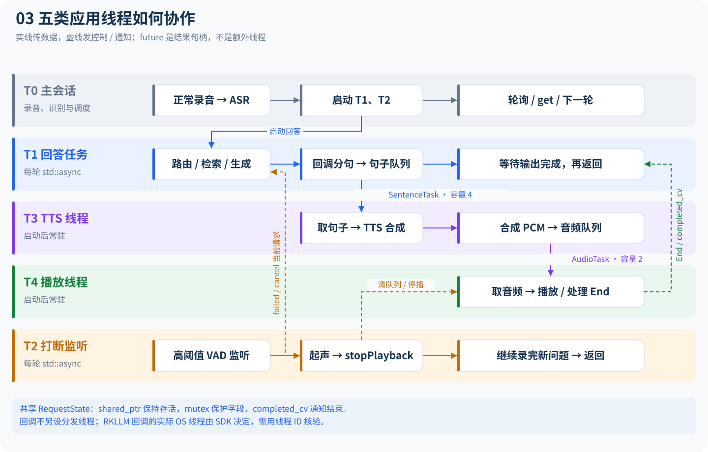

# 项目总览与模块设计

梳理日期：2026-11-04。目标平台：RK3588，PC/WSL 提供开发和验证环境。本文以当前源码为依据，不把旧 README 的板端描述当作实测结论。

图解入口：[完整调用与线程图解](project-flow.md)包含8张分层大图，覆盖主链路、线程、正常完成、起声打断、Agent确认和跨进程调用。

## 1. 项目解决什么问题

系统接受用户语音，判断它是车辆手册问题、一般对话，还是实时设备查询/控制；将回答转换为语音，并支持用户在播报期间起声打断。设备控制由 C++ 工具层执行，LLM 只提出结构化动作。训练代码用于改善小模型的 Planner 输出。

最值得继续深化的工程主线是：**可取消的端侧语音推理流水线，加上可度量的检索和受约束设备执行**。技术栈补充应围绕这条链路产生性能、精度和可靠性证据。

## 2. 三条运行路线

| 路线 | 装配入口 | 使用方式与边界 |
| --- | --- | --- |
| C++ 板端连续语音 | [board_voice_main.cpp](../src/apps/board_voice_main.cpp) | 主线；本地装配音频、语音模型、Retriever、LLM、Agent、Policy |
| C++ 文本与网络联调 | [main.cpp](../src/apps/main.cpp)、[llm_server.cpp](../src/apps/llm_server.cpp)、[rag_server.cpp](../src/apps/rag_server.cpp) | 文本 CLI 使用 MultiLevelResponseSystem；独立服务通过 ZeroMQ 工作 |
| Python 原型与训练 | [python/rag](../python/rag/)、[python/embedding](../python/embedding/)、[python/agent_finetune](../python/agent_finetune/) | TF-IDF RAG、语音实验、ONNX 导出、索引、QLoRA 与离线评测；不是板端入口的必要进程 |

`agent_demo` 是无模型、无音频的Rule Planner独立演示，默认Mock，可用--device iio读取Linux IIO。Host夹具通过不代表真实板端通过，文字入口也不验证ASR/TTS或NPU。

## 3. 板端调用链

1. `BoardAppConfig::load/validate` 读取键值配置，应用入口建立全部后端。
2. `RetrieverRuntime` 拥有检索器；按 `bm25/dense/hybrid` 选择组合，并可包裹相关性过滤器。
3. `createLlmBackend` 创建 Mock 或 RKLLM；同一后端供 Agent Planner 和普通回答使用。
4. `VehicleDevice` 选择 Mock 或 Linux IIO，五种工具注册到 `ToolRegistry`。
5. `agent_planner=auto` 时，Mock 对应 Rule Planner，其余对应 LLM Planner；当前 RK3588 配置显式为 `rule`。
6. `AgentRoutingAnswerBackend` 外层路由先处理安全类别，再处理待确认动作和设备意图，其余交给 `PolicyRoutingAnswerBackend`。
7. `ContinuousVoiceSession` 正常录制 → ASR → 异步 `VoiceAssistant::processText`，同时启动打断 VAD。
8. 回答事件分句后进入句子队列，TTS 线程合成 PCM，音频队列将结果交给播放线程。
9. 起声事件触发 `stopPlayback`，停止本地输出并尝试取消生成；打断录音继续收集下一轮完整问题。回答先结束时仍检查并保留成功录音，已起声则等待录完，不重新采集同一问题。

音频默认为 16 kHz 单声道，数据类型为有符号 PCM16；ASR/TTS 的模型格式和实际采样率仍由相应适配器检查/转换。两个 VAD 录音器引用同一 PCM 源，由连续会话安排不同阶段的采集，不能自行把它们改成任意并行读同一声卡。

## 4. 模块职责与依赖

| 模块 | 输入 → 输出 | 核心职责、依赖和扩展位置 |
| --- | --- | --- |
| `apps` | CLI/配置 → 运行进程 | 负责装配与生命周期，不放可复用算法；所有 main() 集中于此 |
| `config` | argc/argv、键值文件 → 配置对象 | 区分 AppConfig 与 BoardAppConfig；后者校验模型路径、数值和后端配置 |
| `audio` | 声卡/WAV ↔ AudioBuffer | ALSA 采集/播放、取消、WAV 解码；通过 AudioRecorder/AudioPlayer/PcmStreamSource 抽象隔离 |
| `speech` | PCM → 文本；文本 → PCM；PCM → 语音段 | sherpa-onnx C API 适配，PImpl 隐藏 SDK；依赖 AudioBuffer 和音频源接口 |
| `voice` | 问题文本/语音 → 完整会话结果 | 连续轮次、异步回答、起声打断、分句、背压队列、TTS/播放线程 |
| `response` | 查询 + 检索结果 → 路由与回答事件 | 查询分类、旧多级系统、新 Policy、本地 RAG；依赖 Retriever/LlmBackend，不直接访问设备 |
| `retrieval` | chunks/索引/查询 → RetrievalResult 列表 | 分词、BM25、BGE 编码、Dense 搜索、RRF、相关性过滤、运行时装配 |
| `inference` | prompt → 生成结果/chunk | LlmBackend 工厂和 Mock/RKLLM；RKLLM SDK 是可选依赖 |
| `agent` | 用户任务 + Observation → ToolCall/最终答复 | 意图分类、规划、工具白名单、执行循环、确认/取消/超时；依赖设备抽象及 LLM 抽象 |
| `devices` | 设备方法 → 环境读数或状态 | Mock 和 Linux IIO；真实 LED Class 控制还没有实现 |
| `transport` | ZeroMQ 消息 ↔ 结构化请求/事件 | 文本 REQ/REP、流式 DEALER/ROUTER、JSON 编解码、LLM 服务和独立取消服务 |
| `observability` | 会话事件/日志 → PERF_JSON/统计 | 阶段耗时、P50/P95、样本计数和格式校验；尚无算子耗时及硬件资源采样 |
| `common` | 日志消息/时钟/文件 → 公共能力 | Logger、PerfTimer、FNV-1a；头文件还包含 ScopeExit、有界队列 |
| `python/rag` | 手册/音频/问题 → 索引、回答、声音 | TF-IDF 检索、Mock/Ollama/ZMQ 生成、语音原型和联调服务 |
| `python/embedding` | HF 模型/chunks → ONNX 和 f32 向量 | CLS pooling + L2 normalize；PyTorch/ORT 导出对齐、指纹校验 |
| `python/agent_finetune` | 任务数据 → adapter、预测与评测报告 | JSON 工具动作格式、数据划分、QLoRA、heldout 分类统计 |
| `kernel_modules/edge_dht11` | GPIO 边沿 → IIO 温湿度属性 | platform driver、GPIO IRQ、completion、mutex、采样缓存、校验；独立内核构建 |

全部实现文件见[源码索引](source-map.md)，公共方法见[接口参考](api-reference.md)。

## 5. 检索和回答策略

`DocumentChunk.text` 是提供给 LLM 的车辆手册事实。`aliases/retrieval_text` 帮助召回，不能当作额外车辆事实。BM25 使用中文 token；BGE 给查询加检索 instruction 并产生归一化向量。Dense 当前是内存向量搜索，不是 FAISS/ANN。Hybrid 按 chunk_id 合并候选，使用加权 RRF：

```text
fused_score = sparse_weight / (rrf_k + sparse_rank)
            + dense_weight / (rrf_k + dense_rank)
```

RRF 分数、BM25 分数和余弦相似度量纲不同。相关性过滤和直答判断使用原始 sparse/dense 分数，不能拿 RRF 分数直接与 0.40 或 8.0 比较。阈值来源与当前小评测集绑定，新增手册或更换编码器时应重新评估。

普通问答策略包括 Safety、DirectRag、RagLlm、LlmOnly、Clarification。安全问题走固定回复；事实问题在高置信召回时直答，有相关内容但不足直答时交给 RAG+LLM；无检索结果时按查询类别选择 LLM 或澄清。分类当前为启发式规则，confidence 不是校准后的统计概率。

文本 CLI 的 `MultiLevelResponseSystem` 使用 RagOnly/LlmOnly/Hybrid 和进程内缓存。它与板端 Policy 的接口、模式和行为不同；后续统一需要单独做行为对齐。

## 6. Agent 执行协议

`AgentPlanner::plan(context)` 只决定下一步。`AgentExecutor` 查注册表、判断确认要求、调用工具并追加 Observation，再规划下一步。遇到最终回答、错误或步数上限结束。上限实际限制规划循环步数，最终回答也参与步骤判断，不能把它理解为无限次规划下只限制硬件写入次数。

`AgentAnswerBackend` 默认使用固定 `board-voice-session`，使下一轮“确认”能够找到上一轮待执行动作；`request_id` 逐轮变化，承担追踪和取消用途。当前实现适合单设备单会话，不能仅因存在 session_id 参数就宣称支持多租户并发。

写工具在确认前不会执行。超时是访问待确认状态/继续交互时依据时钟检查，并非后台定时器准点清理。取消也不等于对已经完成的硬件动作回滚。推荐条件控制使用 `set_air_conditioner_if_temperature`：确认后在同一工具内重新读取温度、比较条件并决定控制，减少“先查再控”之间条件过期的窗口。

工具 schema 与执行方法详见[通信与数据格式](protocols.md)。现有参数检查由具体工具实现，不是通用 JSON Schema 校验器。

## 7. 线程和所有权

[](diagrams/03-thread-lanes.svg)

点击图片打开大图。逐步时序见[正常完成](project-flow.md#normal)与[起声打断](project-flow.md#interrupt)，锁、共享状态和源码位置见[共享状态表](project-flow.md#shared-state)。

- `VoiceAssistant` 引用回答、TTS、播放后端；这些对象必须比它活得更久。内部任务以 shared_ptr 保存跨线程请求状态。
- `BoundedBlockingQueue` 用 mutex + condition_variable 实现背压；容量默认是句子 4、音频 2。close 唤醒等待者，队列内剩余任务仍可 pop；clear 只清内容，不重新打开已关闭队列。
- `processText` 串行处理请求；不要并发复用同一个 RKLLM handle、Rule Planner/Mock 设备或对其假定线程安全。
- `StreamingSentenceBuffer` 是单线程对象。普通同步/Mock后端沿调用栈执行事件回调；RKLLM直接转发SDK回调，实际OS线程身份需核验。不能持有跨调用失效的引用；会话事件可能来自不同线程，用户回调要自行保护共享资源。
- `BgeEmbedder` 对查询推理加锁，但 load/reload 与查询并发没有通用保证；检索器应在启动阶段加载完成后使用。
- PImpl/unique_ptr 隔离 SDK 资源；取消、stop、析构的先后关系是后续并发学习的重点。

## 8. 当前事实和下一步

当前有 RKLLM 接口，不代表已有 RKNN-Toolkit2 通用网络推理适配；已有 INT8 文件和 QLoRA 脚本，不代表完成了 PTQ 校准或端侧逐层精度分析；已有 PERF_JSON，不代表知道 CPU/NPU 各占多少执行时间；已有 DHT11 IRQ 驱动，也不代表实现过 NPU DMA/Cache/IOMMU。

本次目录调整保留 include 路径与构建目标，运行行为以回归测试保持一致。后续按[技术栈报告](technology-roadmap.md)逐阶段加入量化、profiling、RKNN 和编译实验。

## 9. CMake 构建组织

当前构建采用根目录统一装配、各源码目录维护子 CMake 的结构。各模块通过 `target_sources` 加入同一个 `edge_voice_rag_core`，应用、工具和测试分别在自己的目录定义目标。

| 配置位置 | 负责内容 |
| --- | --- |
| [根 CMakeLists.txt](../CMakeLists.txt) | CMake 最低版本、C/C++ 语言、C++17、输出目录和子目录装配 |
| [EdgeOptions.cmake](../cmake/EdgeOptions.cmake) | 六个可选后端开关、SDK 路径与测试模型/索引路径 |
| [EdgeDependencies.cmake](../cmake/EdgeDependencies.cmake) | JSON、Threads 与可选 ALSA、ORT、sherpa、RKLLM 的查找和检查 |
| [src/CMakeLists.txt](../src/CMakeLists.txt) | 创建核心库、声明公共头文件/依赖，再进入各功能目录 |
| `src/<模块>/CMakeLists.txt` | 本模块的源码、条件编译宏、SDK 头文件和链接依赖 |
| [apps/CMakeLists.txt](../src/apps/CMakeLists.txt) | 文本客户端、服务、演示与板端语音程序 |
| [tools/CMakeLists.txt](../tools/CMakeLists.txt) | 检索 benchmark 和语音性能汇总工具 |
| [tests/CMakeLists.txt](../tests/CMakeLists.txt) | 测试目标、参数、工作目录和可选模型集成测试 |
| [RK3588 工具链](../cmake/toolchains/rk3588-buildroot.cmake) | 使用板厂 Buildroot 的编译器与目标环境 |

配置时先读取选项、查找依赖，然后创建核心库并汇集模块源码，最后定义应用、工具和测试。模块的声明顺序不等于运行时流水线顺序；具体编译、链接顺序由目标依赖决定。

默认关闭六个硬件/模型后端，`BUILD_TESTING` 默认开启。输出程序继续放在构建根目录，例如 `build/agent_demo`；CMake 生成文件和对象文件分布在相应的构建子目录。

### 9.1 构建场景与运行能力

| 场景 | 关键开关/条件 | 能做什么 |
| --- | --- | --- |
| Host诊断 | `EDGE_ENABLE_ASAN/EDGE_ENABLE_UBSAN=ON`，Debug、独立目录 | 为核心库及调用者插桩，按 `board_mainline` 标签检查Mock主线 |
| PC/WSL 默认构建 | 所有 `EDGE_ENABLE_*` 为 OFF | 文本程序、Mock Agent、网络服务、工具和默认测试 |
| 原生 BGE 检索 | `EDGE_ENABLE_BGE_EMBEDDER=ON`，配置 ORT 和 tokenizers-cpp | BGE/Dense/Hybrid；测试开启时还要求模型与索引资产 |
| PC 语音联调 | ALSA、SHERPA_ASR/TTS/VAD 全部 ON | 生成 `board_voice_assistant`，使用 Mock LLM；运行仍需语音模型 |
| RK3588 当前配置 | 四个语音开关 + BGE + RKLLM 全部 ON | 对应 Hybrid 检索、RKLLM 与 IIO 的板端主链 |
| 部署构建 | `BUILD_TESTING=OFF` | 不创建项目测试目标；应用和工具仍保留 |

构建开关决定“哪些实现编入程序”，`config/*.conf` 决定“运行时使用哪些已编入的实现”。例如只在 conf 中写 `llm_backend=rkllm`，不会让未开启 RKLLM 的二进制获得该能力。

### 9.2 常用命令

在 Linux/WSL 项目根目录执行：

```bash
# 配置、编译、运行默认 C++ 测试
cmake -S . -B build -DCMAKE_BUILD_TYPE=Debug
cmake --build build -j4
ctest --test-dir build --output-on-failure

# 只构建一个演示目标
cmake --build build --target agent_demo -j4
./build/agent_demo

# 独立 Release 目录，关闭测试构建
cmake -S . -B build-release -DCMAKE_BUILD_TYPE=Release -DBUILD_TESTING=OFF
cmake --build build-release -j4
```

新增源码时修改所属模块的子 CMake；新增应用、工具、测试分别修改 apps、tools、tests。完整目标表、缓存变量和维护示例见 [CMake 构建指南](cmake-structure.md)，PC 语音和 RK3588 的完整 SDK 参数见[构建运行文档](development.md)。

DHT11驱动的进程/IRQ上下文、2秒缓存、窗口QoS和异常修订，见[驱动专题图解](dht11-driver-guide.md)。该专题补充真实IIO设备内部调用，不改变应用层线程划分。

设备Agent文字入口现支持 `agent_demo --device iio`，由LinuxVehicleDevice读取真实温湿度；默认仍为Mock且始终使用Rule Planner。无需先初始化语音/生成模型，操作见[板端主线联调](board-agent-bringup.md)。空调状态仍为内存逻辑。

连续会话的barge_in_enabled控制回答期间是否启动打断future；关闭时主程序只创建正常VAD，仍异步处理回答并响应stop。既有并发图默认展示开启路径，半双工与开启路径的验收见[主线步骤](board-mainline-acceptance.md)。
