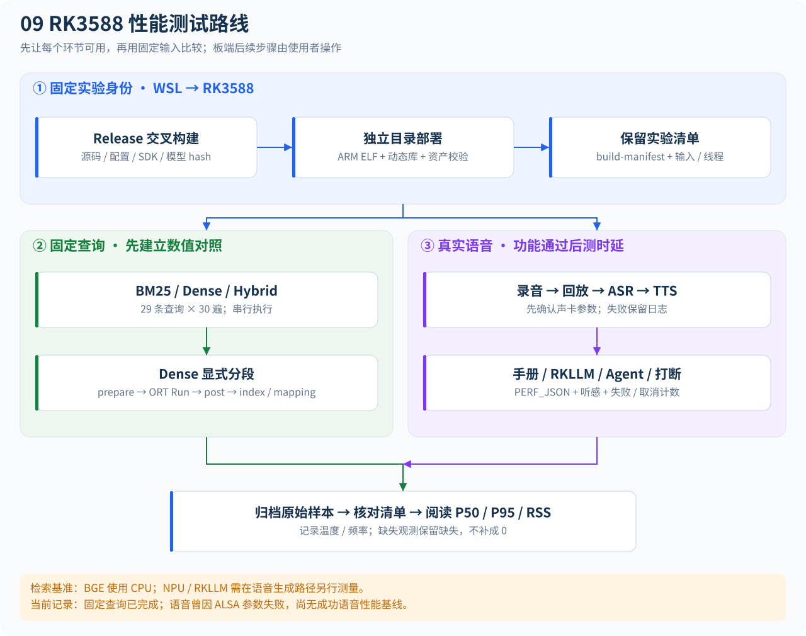
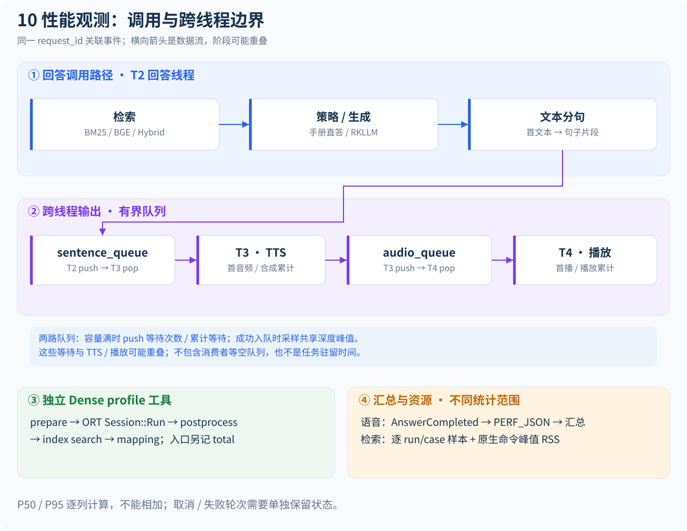

# RK3588 手动性能测试与结果阅读

更新：2026-11-08。后续板端测试由使用者操作；本说明不要求启动Python RAG服务。先打通声卡，再测完整语音链路。已有固定查询结果保留作基线，失败语音记录保留作诊断证据。

## 1. 测试全貌





图中的阶段是观测范围，不是可以相加的独立耗时。更完整的线程/取消路径见[项目流程图](project-flow.md)，字段定义见[性能指南](performance-guide.md)。

## 2. 当前板端环境与模型

连接为 `ssh root@192.168.10.100`。开发板报告ATK-DLRK3588，Linux6.1.141 / aarch64 / Buildroot2024.02，声卡名称 `rockchipes8388`。板端墙钟曾显示1970年；应用使用单调时钟测耗时，但记录日期应同时注明操作者时间。

| 项目 | 当前实际内容 |
| --- | --- |
| 普通生成模型 | `models/llm/deepseek-1.5b-w8a8-rk3588.rkllm` |
| Planner | `agent_planner=rule`，使用RuleAgentPlanner，不调用模型规划 |
| 已训练资产 | 本机有Qwen2.5-3B Planner LoRA的v1/v2/v3适配器；v3元数据的base为Qwen/Qwen2.5-3B-Instruct、r=8、alpha=16 |
| 适配器部署状态 | 当前配置没有加载上述适配器；本机列出的RKLLM文件仍是DeepSeek文件。尚无已验证的合并→RKLLM转换→板端对齐闭环 |
| 温湿度设备 | 原始配置选iio；此前未枚举到edge_dht11，失败语音尝试单独改为mock；Mock读数不是传感器实测 |

因此，当前运行的不是之前QLoRA训练得到的Planner。LoRA adapter是相对于Qwen基础模型的增量，不能直接套在DeepSeek模型上，也不能仅改文件名当作RKLLM模型。切换前需要选定通过heldout评测的版本，合并对应基础模型，按RKLLM工具链转换并做板端工具JSON/确认/拒绝/参数验证回归；这些步骤尚未在本次执行。

若把原模型设为 `agent_planner=llm`，它会进入要求结构化工具JSON的LlmAgentPlanner；通用模型输出不符合协议可能报错，具体原因需看原日志。保留rule可先完成板端设备主线。此前语音失败的直接错误是ALSA播放参数，不是已经确认的Planner错误。

## 3. 已部署目录与使用原则

旧部署 `/userdata/EdgeVoiceRAG` 保持原状；新二进制/库/检索资产位于：

```sh
BUNDLE=/userdata/edge_voice_perf/rk3588-perf-20261108-4b4fc2a2
export LD_LIBRARY_PATH="$BUNDLE/lib${LD_LIBRARY_PATH:+:$LD_LIBRARY_PATH}"
cd "$BUNDLE"
sha256sum -c bundle.sha256
ldd bin/board_voice_assistant
```

校验必须通过，ldd不得出现not found。此目录包含匹配的ARM动态库、四个程序、BGE/索引/查询集与交叉构建清单。ASR/TTS/VAD/LLM大权重继续使用旧部署中的资产，不在新包里重复复制。

从WSL重新打包时，先按[开发文档](development.md)完成Release交叉编译，再执行：

```bash
cmake --build build-rk3588-bge --target board_voice_assistant retrieval_benchmark bge_retrieval_profile voice_performance_summary -j4
python3 tools/prepare_rk3588_perf.py --build-dir build-rk3588-bge \
  --output .cache/rk3588-deploy/my-new-rk3588-bundle
```

输出目录和同名tar.gz必须不存在。工具验证AArch64 ELF，递归收集动态依赖，保存源码/构建/资产hash，并生成bundle.sha256。它不负责烧写DTB、加载内核模块或覆盖板端旧部署。已有包的build-manifest.json归档的是打包时状态，不能代表此后工作树的修改。

## 4. 先单独确认录音和播放

以下命令由你在板端SSH终端执行。先用 `arecord -l` / `aplay -l` 确认设备，再选本次独立目录。录音后说一句短句：

```sh
AUDIO="$BUNDLE/results/manual-audio-01"
mkdir "$AUDIO" || exit 1
arecord -l
aplay -l
arecord -D plughw:CARD=rockchipes8388,DEV=0 -f S16_LE -r 16000 -c 1 -d 5 "$AUDIO/mic.wav"
aplay -D plughw:CARD=rockchipes8388,DEV=0 "$AUDIO/mic.wav"
```

通过标准：文件非空，回放能听清刚说的话；这只证明基础录放音，不证明ASR/TTS/Agent通过。

此前完整语音尝试已失败，保留在 `$BUNDLE/results/live-voice-01/voice.log`，末尾为：

```text
[ASR] 。
[BARGE-IN] 检测到用户打断
[ASR] 怎么打开？
ALSA playback failed: failed to apply playback parameters: Invalid argument
```

需要先解决播放参数。失败配置已经使用plughw，因此仅把hw改成plughw不能视为本次问题已修复；仍需检查TTS实际输出与ALSA参数协商。可用 `aplay --help` 确认选项，再以 `aplay -D hw:CARD=rockchipes8388,DEV=0 --dump-hw-params "$AUDIO/mic.wav"` 查看硬件约束；若原生hw不支持16k/mono，而plughw可播放，说明需要ALSA格式转换。应用录音固定16k/mono/512帧，播放period_frames=1024，采样率来自TTS音频；配置中可以选择capture_device/playback_device，period不能通过当前conf更改。不要仅凭这条日志断言是采样率、声道或period中的哪一个。

## 5. 完整语音链路：先功能，再性能

复用已归档的独立语音配置作为起点，不改原始部署配置：

```sh
VOICE="$BUNDLE/results/manual-voice-01"
mkdir "$VOICE" || exit 1
cp "$BUNDLE/results/live-voice-01/voice.conf" "$VOICE/voice.conf"
vi "$VOICE/voice.conf"
```

核对：`capture_device` 和 `playback_device` 为声卡测试通过的设备；`max_turns=3`；`agent_planner=rule`；`agent_device_backend=mock` 可先隔离传感器问题。这份配置为上次尝试设置 `llm_max_new_tokens=64`，正式性能对比需固定并记录，不能与默认256无说明混用。接通真实DHT11并枚举后再改iio，接线见[DHT11说明](hardware-dht11.md)。

启动后依次说三句，每句等待播报结束；另开SSH窗口用tail观察日志，重定向日志可能要等缓冲刷新：

```sh
cd /userdata/EdgeVoiceRAG
"$BUNDLE/bin/board_voice_assistant" "$VOICE/voice.conf" >"$VOICE/voice.log" 2>&1
VOICE_EXIT=$?
echo "$VOICE_EXIT" >"$VOICE/exit-code.txt"
cat "$VOICE/voice.log"
```

| 说什么 | 验证什么 | 通过标准 |
| --- | --- | --- |
| 空调怎么打开 | VAD→ASR→手册路由→分句/TTS/播放 | ASR语义正确，回答与手册一致且可听见 |
| 给我讲一个简短的笑话 | 普通生成/RKLLM路径 | 日志实际路由到生成，能完整播报，无错误 |
| 车内温度是多少 | Agent规则规划→工具→语音 | 返回设备后端的温度；mock时明确为模拟值 |

之后用独立目录增加打断场景：长回答播报中说新问题，观察停止旧播报、旧request_id不再输出、新请求完成。写操作可测“打开空调→确认/取消”，当前空调/LED仍为内存状态，不代表真实执行器控制。

没有真实edge_dht11时，iio温湿度测试应记为“未验证”，不能用mock替代通过。未识别、无播报或程序失败时，先保存整段日志、退出码、conf和模型hash，解决功能后再统计性能。

有正常完成的PERF_JSON后：

```sh
"$BUNDLE/bin/voice_performance_summary" "$VOICE/voice.log" >"$VOICE/summary.txt"
cat "$VOICE/summary.txt"
```

首文本、首音频、首播、总时延和两路queue push等待一起看。取消/失败轮次可能没有AnswerCompleted报告，必须单独计数；汇总中没有观测的字段不能当0ms，阶段时长和各列P50不能直接相加。当前失败尝试不作为三轮成功语音性能结果。

## 6. 固定查询复测

在板端回到包根目录，选新的结果目录；三个backend串行，避免争抢CPU：

```sh
cd "$BUNDLE"
OUT="$BUNDLE/results/manual-retrieval-01"
mkdir "$OUT" || exit 1
for backend in bm25 dense hybrid; do
  python3 tools/run_retrieval_baseline.py \
    --build-dir bin --build-manifest build-manifest.json \
    --backend "$backend" --filter --runs 30 \
    --chunks vector_db/chunks.json --cases benchmarks/retrieval_cases.json \
    --model-dir models/embedding/bge-small-zh-v1.5 \
    --index-dir vector_db/bge-small-zh-v1.5 \
    --output "$OUT/$backend-benchmark" || break
done
python3 tools/run_retrieval_baseline.py \
  --build-dir bin --build-manifest build-manifest.json \
  --mode profile --backend dense --runs 30 --threads 4 --warmup 1 \
  --chunks vector_db/chunks.json --cases benchmarks/retrieval_cases.json \
  --model-dir models/embedding/bge-small-zh-v1.5 \
  --index-dir vector_db/bge-small-zh-v1.5 --output "$OUT/dense-profile"
```

每组应有29×30=870个唯一run/case样本，manifest.status=complete。benchmark启用过滤；profile不启用过滤。BGE在ORT CPU上执行，这些检索数值不是NPU/RKLLM性能。每组manifest记录构建来源、模型/索引/输入/二进制/动态库hash、CPU亲和性、可读温度/频率、timer和进程峰值RSS；板端不需要Git或原生编译器。

## 7. 已完成固定输入结果

这是用户要求改为自行操作之前完成的一组实测，原始结果在板端 `$BUNDLE/results/run30-4001ae1e`，本机副本在 `perf_logs/2026-11-08-rk3588-collected/results/run30-4001ae1e`（Git忽略，需单独备份）。

| 后端 | RK3588 P50 / P95（ms） | 原生命令峰值RSS（KiB） | 样本 |
| --- | --- | --- | --- |
| BM25 | 0.009917 / 0.020125 | 14356 | 870 |
| Dense | 8.866958 / 10.288542 | 169812 | 870 |
| Hybrid | 8.935209 / 10.107125 | 170064 | 870 |
| Dense显式分段total | 8.915083 / 10.069792 | 169688 | 870 |

Dense分段P50：prepare=0.139417ms，ORT Session::Run=8.731625ms，postprocess=0.022750ms，index=0.006417ms，mapping=0.005834ms。这是应用层分段，不是逐算子trace；不能将Session::Run视为纯硬件计算时间。

基准使用Release、top_k=3、BGE intra=4/inter=1，逐组新进程，不清空文件缓存。三组检索在24正例/5负例的小型开发集上质量指标均为1.0；不代表泛化能力。RSS覆盖模型加载、预热、采样与输出，不是每次查询的内存，更不是整个语音助手的内存。CPU秒数由BusyBox time记录，精度有限；无CPU/NPU占比。

[Host基线](experiments/2026-11-08-observability-baseline.md)的Dense P50=3.391409ms、Hybrid P50=3.440451ms，可作为不同设备的对照；不是一次优化的前后收益。对比前应以两侧manifest核对原生源码、模型/索引/查询hash，记录器在板端适配后版本有变化。

四组清单状态和样本数已核对。打包文件SHA256为 `034e232b31c5f45b4c26d8fe143e102c7f59f5b8227c7243ab93f299706623db`。未完成范围：成功的真实语音性能基线、DHT11连续稳定性与Agent真实传感器联调、微调Planner板端验证、ORT算子trace及CPU/NPU利用率。

后续硬件进展：2026-11-09使用者已完成一帧DHT11读取，得到31℃ / 38%RH且通过校验和；见[单次读取记录](experiments/2026-11-09-dht11-first-read.md)。这不改变此前语音链路的失败状态。

DHT11采集进展：0.2.1用户A/B为普通0/5、外部CPU延迟约束5/5；[0.2.2窗口请求修订](experiments/2026-11-09-dht11-qos-window.md)已完成本地验证，新版板端验证待执行。这是传感器诊断结果，不是完整语音或Agent性能基线。

2026-11-10传感器更新：0.2.2 I/O为10/10，耗时约23.6～25.1ms；首条0.4℃存疑，见[质量核对记录](experiments/2026-11-10-dht11-window-qos-10read.md)。本轮尚未证明传感器数据全部正确，也未验证Agent或完整语音。

用户补充后续传感器测试没有问题，按要求结束首条专项追查；历史数值保留，不补造额外样本。驱动调用、IRQ与QoS关系见[驱动图解](dht11-driver-guide.md)。

## 2026-11-10录放音采样率修订

用户新日志明确ASoC unmatched rate symmetry:16000/44100。板端配置现选edge_voice_16k，启动前export ALSA_CONFIG_PATH="$PWD/config/alsa-rk3588.conf"，保持VAD/ASR输入16k并将TTS源44.1k转换为同一硬件16k。前文旧plughw失败日志保留作为历史，当前操作以[修复与更新包](rk3588-duplex-fix.md)为准；此修复不替代新的板端性能与可听验证。
