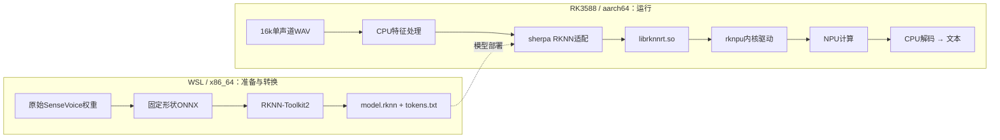

# SenseVoice → RKNN：手动操作学习手册

核对日期：2026-11-12。本页是给使用者执行的操作步骤，**尚未执行其中的下载、编译、转换或板端命令**。当前项目仍使用CPU ASR。思考文本过滤继续按用户要求挂起。

先完成第1～3节并保存输出，再继续后面的操作。每一步理解“输入、执行位置、产物、通过条件”，遇到错误保留完整日志，停在该步排查。

## 1. 这次要学会什么

| 阶段 | 你做的事 | 能证明什么 |
| --- | --- | --- |
| A | 核对板端环境，运行官方RKNN模型 | Runtime/驱动/模型链路可用 |
| B | 同一录音跑CPU与RKNN | 初步正确性与性能对照 |
| C | 自己交叉编译带RKNN的sherpa | 理解编译开关、架构与动态库 |
| D | 原始权重 → 固定形状ONNX → 非量化RKNN | 自己完成导出与转换 |
| E | 校准/PTQ/heldout，最后接入项目 | 建立精度分析与完整语音验收 |

当前先做ASR。TTS保持已经能用的CPU方案，RKLLM继续负责LLM。ASR运行完成后才开始一轮问答，先避免多个NPU任务同时干扰独立测量。



先运行官方现成的model.rknn，可以跳过左侧转换过程。Toolkit2是Host转换工具，librknnrt是板端C/C++运行库，驱动负责硬件交互；板端运行现成模型不需要先装Toolkit2。组件职责见[瑞芯微官方说明](https://github.com/airockchip/rknn-toolkit2/tree/v2.2.0)。

## 2. 当前项目起点与版本

本机只读检查得到：

- sherpa源码：/home/xx/rk3588_third_party/sherpa-onnx。
- 版本v1.13.4，提交142807252687d81b40d6315f23470a1512a00de3；本教程先固定这个版本，方便与现有代码对应。
- 已安装ARM SDK：/home/xx/rk3588_third_party/sherpa-onnx-rk3588；其原构建缓存中SHERPA_ONNX_ENABLE_RKNN=OFF、SHERPA_ONNX_ENABLE_BINARY=OFF。
- [板端入口](../src/apps/board_voice_main.cpp)当前显式设置provider=cpu，现有项目配置没有可直接切换的asr_provider。
- 当前CPU模型：models/asr/sherpa-onnx-sense-voice-zh-en-ja-ko-yue-int8-2024-07-17/model.int8.onnx。
- 板端现有工程位置按/userdata/EdgeVoiceRAG举例，SSH为root@192.168.10.100。

**因此：改成.rknn路径并不能完成接入。** 需要模型、支持RKNN的SDK、Runtime/驱动和应用选择逻辑一致。实验全程使用独立目录，现有部署保持可用。

以下代码块标明WSL Bash或板端Shell；不要直接贴进PowerShell。相同阶段尽量使用同一终端，变量不会跨终端自动保留。

## 3. 第一步：只读确认板端环境

**执行位置：RK3588板端Shell。** 先结束正在运行的run.sh，在它的终端按Ctrl+C，等程序正常退出。

```sh
uname -a
uname -m
getconf LONG_BIT
cat /proc/device-tree/model
echo
ls -l /dev/dri/renderD* /dev/rknpu* 2>/dev/null
dmesg | grep -iE 'rknpu|rknn' | tail -n 40

for p in /lib/librknnrt.so /usr/lib/librknnrt.so /usr/lib/aarch64-linux-gnu/librknnrt.so /userdata/EdgeVoiceRAG/lib/librknnrt.so; do
    if [ -f "$p" ]; then
        echo "runtime=$p"
        ls -l "$p"
        sha256sum "$p"
        strings "$p" | grep 'librknnrt version'
    fi
done
```

理解输出：

- uname -m应为aarch64，位数应为64。
- 设备节点因系统实现不同而异，未出现/dev/rknpu不直接表示没有NPU；结合/dev/dri与驱动日志判断。
- 若上面没有找到Runtime，再运行find /lib /usr/lib /userdata/EdgeVoiceRAG -name 'librknnrt.so*'，核对实际路径。
- 历史日志中的rknpu驱动0.9.8只是旧记录，以本次输出为准；RKLLM版本也不等于librknnrt版本。

**本轮先把这一步输出发回即可。** 后面的版本/依赖检查通过后再运行模型，不需要先升级系统驱动。

## 4. 第二步：WSL准备独立的官方参考实验

### 4.1 建立新目录，下载固定版本

**执行位置：WSL Bash。** 首次执行：

```bash
LAB=$(mktemp -d "$HOME/rknn-asr-lab-XXXXXX")
printf '记下实验目录：%s\n' "$LAB"
cd "$LAB"

SDK=sherpa-onnx-v1.13.4-rknn-linux-aarch64-shared
MODEL=sherpa-onnx-rk3588-20-seconds-sense-voice-zh-en-ja-ko-yue-2024-07-17

curl -fL --retry 3 -o "$SDK.tar.bz2" \
  "https://github.com/k2-fsa/sherpa-onnx/releases/download/v1.13.4/$SDK.tar.bz2"
curl -fL --retry 3 -o "$MODEL.tar.bz2" \
  "https://github.com/k2-fsa/sherpa-onnx/releases/download/asr-models/$MODEL.tar.bz2"

sha256sum "$SDK.tar.bz2" "$MODEL.tar.bz2" | tee download-sha256.txt
tar -tjf "$SDK.tar.bz2" | head
tar -tjf "$MODEL.tar.bz2" | head
tar -xjf "$SDK.tar.bz2"
tar -xjf "$MODEL.tar.bz2"
ls "$SDK/bin"
ls "$SDK/lib"
ls "$MODEL"
file "$SDK/bin/sherpa-onnx-offline"
```

预期：程序是ARM aarch64 ELF，模型目录包含model.rknn、tokens.txt及测试音频。**WSL不能直接执行这个ARM程序**，这里只检查和准备文件。

版本依据：[v1.13.4发布](https://github.com/k2-fsa/sherpa-onnx/releases/tag/v1.13.4)、[官方模型入口](https://k2-fsa.github.io/sherpa/onnx/rknn/models.html)。官方网页示例可能随新版变化，本教程固定版本，不把最新版库混入旧工程。

20秒只是首次参考形状。官方另有5/10/15/25/30秒版本；短输入会补齐，超长会截断。后面用短句和较长句选形状，不能把超过上限的音频静默截断后计作成功。

### 4.2 整理要传到板端的内容

仍在同一WSL终端：

```bash
cd "$LAB"
mkdir -p bundle/bin bundle/lib bundle/models/cpu bundle/models/rknn bundle/logs
cp "$SDK/bin/sherpa-onnx-offline" bundle/bin/
cp -a "$SDK/lib/." bundle/lib/
cp -a "$MODEL/." bundle/models/rknn/

CPU=/home/xx/EdgeVoiceRAG/models/asr/sherpa-onnx-sense-voice-zh-en-ja-ko-yue-int8-2024-07-17
test -s "$CPU/model.int8.onnx" && test -s "$CPU/tokens.txt"
cp "$CPU/model.int8.onnx" "$CPU/tokens.txt" bundle/models/cpu/
cp download-sha256.txt bundle/
```

保留整套SDK库和模型配套tokens，不用旧工程的sherpa/ORT库拼凑新实验。CPU资产检查失败时先准备实际模型，不能创建空文件代替。

Runtime分两种情况：

1. 板端已有librknnrt：先检查版本和模型初始化结果。系统默认位置可直接被加载；仅在工程私有目录中时，可复制一份到实验lib，记录来源与hash。
2. 板端没有或版本不兼容：可在WSL下载官方2.2.0 Runtime作为**独立实验候选**，不覆盖系统库：

```bash
curl -fL --retry 3 -o "$LAB/bundle/lib/librknnrt.so" \
  https://raw.githubusercontent.com/airockchip/rknn-toolkit2/v2.2.0/rknpu2/runtime/Linux/librknn_api/aarch64/librknnrt.so
file "$LAB/bundle/lib/librknnrt.so"
strings "$LAB/bundle/lib/librknnrt.so" | grep 'librknnrt version'
sha256sum "$LAB/bundle/lib/librknnrt.so"
```

只在需要时执行这段。若下载内容是HTML或Git LFS指针，停止，重新获取实际ELF。[官方安装页](https://k2-fsa.github.io/sherpa/onnx/rknn/install.html)提供2.2.0作为RK3588已知可工作的参考，**这不保证本板驱动与任意模型均兼容**。以实际加载版本、初始化日志和推理结果为准。

### 4.3 传输，避免覆盖现有目录

WSL先打包：

```bash
cd "$LAB"
tar -czf rknn-asr-lab.tar.gz -C bundle .
sha256sum rknn-asr-lab.tar.gz
ssh root@192.168.10.100 \
  'test ! -e /userdata/rknn-asr-lab.tar.gz && cat > /userdata/rknn-asr-lab.tar.gz' \
  < rknn-asr-lab.tar.gz
```

该方式通过SSH标准输入传输，不依赖板端SFTP。已有同名归档时命令停止，可另取新名字，不覆盖旧实验。

**执行位置：板端Shell：**

```sh
sha256sum /userdata/rknn-asr-lab.tar.gz
mkdir /userdata/rknn-asr-lab
tar -xzf /userdata/rknn-asr-lab.tar.gz -C /userdata/rknn-asr-lab
cd /userdata/rknn-asr-lab
```

先核对hash与WSL一致。mkdir如提示目录已存在，停下另选新目录；重连时cd到已经建立的目录即可。

### 4.4 检查动态库，再看命令帮助

**执行位置：板端Shell：**

```sh
cd /userdata/rknn-asr-lab
LD_LIBRARY_PATH="$PWD/lib" ldd ./bin/sherpa-onnx-offline
LD_LIBRARY_PATH="$PWD/lib" ./bin/sherpa-onnx-offline --help > logs/help.txt 2>&1
grep -E 'provider|num-threads|sense-voice|tokens' logs/help.txt
```

ldd应解析到实验目录的sherpa/ORT库，librknnrt解析到选定路径，无not found。帮助应包含--provider、--sense-voice-model、--tokens、--sense-voice-language、--sense-voice-use-itn。

若Runtime只在旧工程lib中且想先测试这份，确认实验lib还没有同名文件，再执行：

```sh
test ! -e lib/librknnrt.so && cp -L /userdata/EdgeVoiceRAG/lib/librknnrt.so lib/librknnrt.so
sha256sum lib/librknnrt.so
```

然后重跑ldd。不要把整个旧工程lib目录加入此实验的LD_LIBRARY_PATH，避免意外选中旧sherpa/ORT。--help的退出码可能非0，先读内容；初始化或库加载报错则不能继续。

## 5. 第三步：同一录音比较CPU与RKNN

### 5.1 先用模型自带WAV确认程序可运行

**执行位置：板端Shell：**

```sh
cd /userdata/rknn-asr-lab
ls models/rknn/test_wavs
WAV="$PWD/models/rknn/test_wavs/zh.wav"
test -s "$WAV"
```

没有zh.wav时，从实际test_wavs中选一个已有文件替换WAV。首次先跑下面的CPU命令，再跑RKNN命令，不要同时启动。

```sh
LD_LIBRARY_PATH="$PWD/lib" ./bin/sherpa-onnx-offline \
  --provider=cpu --num-threads=2 \
  --sense-voice-model=./models/cpu/model.int8.onnx \
  --tokens=./models/cpu/tokens.txt \
  --sense-voice-language=zh --sense-voice-use-itn=true \
  "$WAV" > logs/reference-cpu.txt 2>&1
echo "cpu_rc=$?"
cat logs/reference-cpu.txt
```

```sh
LD_LIBRARY_PATH="$PWD/lib" ./bin/sherpa-onnx-offline \
  --provider=rknn --num-threads=-1 \
  --sense-voice-model=./models/rknn/model.rknn \
  --tokens=./models/rknn/tokens.txt \
  --sense-voice-language=zh --sense-voice-use-itn=true \
  "$WAV" > logs/reference-rknn.txt 2>&1
echo "rknn_rc=$?"
cat logs/reference-rknn.txt
```

这里的--num-threads有两套语义：CPU=2为两个推理线程；在v1.13.4 RKNN模式下，-1选择NPU core 1，0选择core 0，-2选择core 2，-3选择0+1，-4选择0+1+2，1为自动选择。依据是固定版本[offline-model-config.cc](https://github.com/k2-fsa/sherpa-onnx/blob/v1.13.4/sherpa-onnx/csrc/offline-model-config.cc)。

先使用官方常见示例的-1，不立即做多核调优。**不要把-1填入本项目asr_num_threads**，当前配置和ASR适配层均校验正数，接入时应另行设计NPU核选择，并按provider调整适配层校验。

通过条件：两次退出码为0，RKNN日志实际初始化Runtime/模型，文本合理。只有provider参数不够证明走了NPU；保存Runtime/驱动/模型版本输出，有需要再观察驱动负载节点。若当前二进制明确报告未启用RKNN，核对归档与ldd，不能把CPU回退计作成功。

### 5.2 录下自己的固定输入

保持主程序停止。在**板端Shell**用子Shell加载现有ALSA配置，避免污染实验动态库环境：

```sh
(
    cd /userdata/EdgeVoiceRAG || exit
    . ./env.sh
    arecord -D edge_voice_16k -f S16_LE -r 16000 -c 1 -d 5 \
      /userdata/rknn-asr-lab/temperature.wav
)
```

5秒内清楚说：“现在温度是多少？”不要同时运行主程序抢占声卡。该命令依赖现有部署的env.sh与edge_voice_16k ALSA profile，缺失时按[录放音手册](board-audio-output.md)先核对配置。

再分别录“打开空调”“取消”，每句一份新文件。记录实际所说的参考文本、采样格式、时长和WAV hash。用自己的文件替换WAV，重跑5.1的两条命令，输出保存为新的日志名。

### 5.3 如何学习看性能

| 观察项 | 记录方法与意义 |
| --- | --- |
| 文本、命令词、数值 | 同录音、同语言与ITN，先检查“温度/湿度/打开/关闭/取消”和数字 |
| 初始化耗时 | 与解码耗时分列；重复启动进程会重复加载模型 |
| 解码时间与RTF | 使用同一工具日志的相同统计字段；RTF=该段处理耗时/原始音频秒数 |
| 总进程耗时 | 包括启动/加载/解码；不能与项目仅asr_elapsed_ms混比 |
| 冷/热 | 新进程可能命中文件缓存；真正的同进程预热需后续常驻基准 |
| 内存与负载 | 后续按[性能口径](performance-guide.md)记录RSS/频率/温度，负载不能由耗时猜测 |

每条先跑3次用于熟悉流程，保留逐次结果；这不够发布P95。正式评估另准备至少30条独立录音，覆盖噪声、数字、短句和较长句，按固定规范计算CER与命令词/数值准确率。

官方参考CPU INT8与官方RKNN模型的精度路径可能不同，这是部署路线对照，**不是你自行完成的INT8量化消融**。20秒静态输入即使只录3秒也可能有较多padding，先看到结果，再决定是否测试5/10秒形状。

## 6. 第四步：自己交叉编译RKNN SDK

前3步通过后再做。本阶段输入是sherpa源码和aarch64 Runtime/头文件，产物是带RKNN的ARM库与独立ASR程序。WSL负责编译，板端负责运行。

**执行位置：WSL Bash。** 回到已记录的LAB；以下假定仍有该变量：

```bash
test -d "$LAB/bundle"
git clone --branch v1.13.4 --depth 1 \
  https://github.com/k2-fsa/sherpa-onnx.git "$LAB/sherpa-src"
git -C "$LAB/sherpa-src" rev-parse HEAD

git clone --branch v2.2.0 --depth 1 \
  https://github.com/airockchip/rknn-toolkit2.git "$LAB/rknn-toolkit2"
git -C "$LAB/rknn-toolkit2" rev-parse HEAD

RKNN_API="$LAB/rknn-toolkit2/rknpu2/runtime/Linux/librknn_api"
test -s "$RKNN_API/include/rknn_api.h"
file "$RKNN_API/aarch64/librknnrt.so"
```

若.so是LFS指针，先按4.2从固定tag下载真实库到独立目录，再让下面LIB_DIR指向那个目录。源码头文件与Runtime使用同一候选版本；记录最终板端实际加载的库，不能只记录编译链接路径。

本机现有板厂工具链文件如下；换机器时必须替换实际路径：

```bash
TOOLCHAIN=/home/xx/rk3588_linux_sdk/buildroot/output/alientek_rk3588/host/share/buildroot/toolchainfile.cmake
test -f "$TOOLCHAIN"

export SHERPA_ONNX_RKNN_TOOLKIT2_LIB_DIR="$RKNN_API/aarch64"
export CPLUS_INCLUDE_PATH="$RKNN_API/include${CPLUS_INCLUDE_PATH:+:$CPLUS_INCLUDE_PATH}"
export LIBRARY_PATH="$RKNN_API/aarch64${LIBRARY_PATH:+:$LIBRARY_PATH}"

cmake -S "$LAB/sherpa-src" -B "$LAB/build-asr" \
  -DCMAKE_TOOLCHAIN_FILE="$TOOLCHAIN" \
  -DCMAKE_BUILD_TYPE=Release \
  -DCMAKE_INSTALL_PREFIX="$LAB/install-asr" \
  -DBUILD_SHARED_LIBS=ON \
  -DSHERPA_ONNX_ENABLE_BINARY=ON \
  -DSHERPA_ONNX_ENABLE_C_API=ON \
  -DSHERPA_ONNX_ENABLE_RKNN=ON \
  -DSHERPA_ONNX_ENABLE_TTS=OFF \
  -DSHERPA_ONNX_ENABLE_SPEAKER_DIARIZATION=OFF \
  -DSHERPA_ONNX_ENABLE_PORTAUDIO=OFF \
  -DSHERPA_ONNX_ENABLE_WEBSOCKET=OFF \
  -DSHERPA_ONNX_ENABLE_PYTHON=OFF \
  -DSHERPA_ONNX_ENABLE_TESTS=OFF \
  -DSHERPA_ONNX_BUILD_C_API_EXAMPLES=OFF \
  -DSHERPA_ONNX_ENABLE_GPU=OFF
cmake --build "$LAB/build-asr" -j4
cmake --install "$LAB/build-asr"
file "$LAB/install-asr/bin/sherpa-onnx-offline"
```

这组参数按本地v1.13.4源码核对，尚未实编。CMake会准备依赖，联网下载失败时先解决下载，不修改业务源码绕过。检查CMakeCache中的编译器、处理器和RKNN=ON，不允许混入Host的x86库。上游[交叉编译脚本](https://github.com/k2-fsa/sherpa-onnx/blob/v1.13.4/build-rknn-linux-aarch64.sh)可用于对照，但它使用通用aarch64-linux-gnu工具链并准备ALSA，与本机板厂工具链并非同一套配置。

将install-asr的bin/lib和选定Runtime放进**第二个独立板端实验目录**，复用相同WAV/model/tokens，重做ldd和5.1。先确认官方预编译和自己的构建结果一致。

本节关闭TTS只为缩小独立ASR学习范围；**不能把这份ASR-only SDK直接替换完整语音主线SDK**。后面集成必须保留TTS/VAD/BGE需要的能力，并对齐ORT ABI。

## 7. 第五步：自己从原始权重导出、转换

### 7.1 新建Host Python环境

本阶段在**WSL x86_64**执行。不要在板端装转换依赖，不改项目已有edge-rag环境。先确认有Python3.10，再用它创建独立venv；本机已有解释器可作为创建入口：

```bash
/home/xx/miniconda3/envs/edge-rag/bin/python --version
/home/xx/miniconda3/envs/edge-rag/bin/python -m venv "$LAB/venv-convert"
source "$LAB/venv-convert/bin/activate"
python --version
python -m pip install --upgrade pip
python -m pip install "numpy==1.26.4" \
  "torch==2.0.0+cpu" --extra-index-url https://download.pytorch.org/whl/cpu
python -m pip install "onnx==1.17.0" "onnxruntime==1.17.1" \
  sentencepiece soundfile kaldi-native-fbank librosa onnxsim \
  "rknn-toolkit2==2.2.0"
python -m pip check
python -m pip freeze > "$LAB/conversion-environment.txt"
```

解释器不是3.10时先建立独立3.10环境。依赖冲突则停下记录输出，不用--no-deps强行越过。

上游v1.13.4的[导出工作流](https://github.com/k2-fsa/sherpa-onnx/blob/v1.13.4/.github/workflows/export-sense-voice-to-rknn.yaml)使用Python3.10、Torch2.0、ORT1.17.1和Toolkit2 2.1.0；本教程选官方可安装的2.2.0作为实验候选，与前面的Runtime保持同系列，**不是已验证复现上游2.1.0产物**。保存freeze、转换日志和板端版本用于定位差异。

### 7.2 固定原始资产版本，导出20秒ONNX

从[SenseVoice原始仓库](https://huggingface.co/FunAudioLLM/SenseVoiceSmall/tree/main)复制具体revision的提交号，替换下面的占位符。不要把main写作“固定版本”。

```bash
mkdir "$LAB/export-sensevoice"
cd "$LAB/export-sensevoice"
cp "$LAB/sherpa-src/scripts/sense-voice/rknn/"*.py .

REV=替换为SenseVoice仓库的实际commit
for name in model.pt am.mvn chn_jpn_yue_eng_ko_spectok.bpe.model; do
    curl -fL --retry 3 -o "$name" \
      "https://huggingface.co/FunAudioLLM/SenseVoiceSmall/resolve/$REV/$name"
done
sha256sum model.pt am.mvn chn_jpn_yue_eng_ko_spectok.bpe.model > source-sha256.txt
printf '%s\n' "$REV" > source-revision.txt

set -o pipefail
python export-onnx.py --input-len-in-seconds 20 2>&1 | tee export-onnx.log
ls -lh model-20-seconds.onnx tokens.txt
```

model.pt是原始浮点权重，am.mvn是归一化参数，bpe.model是词表来源。导出脚本会生成tokens.txt并写入sherpa需要的ONNX元数据；不要拿现有model.int8.onnx做这一阶段的原始基线。

输入是固定长度特征x和prompt，**不是WAV字节**。脚本会根据20秒生成固定帧数，后续SDK负责音频到特征的处理。

先用CPU验证自己导出的ONNX（WAV路径指向4.1下载模型中的实际文件）：

```bash
python test_onnx.py \
  --model model-20-seconds.onnx --tokens tokens.txt \
  --wave "$LAB/$MODEL/test_wavs/zh.wav" \
  --language zh --use-itn 1 2>&1 | tee test-onnx.log
```

文本不合理时先检查原始资产、词表、CMVN与导出，不继续量化。

### 7.3 转换非量化RKNN，先建立正确性

```bash
python export-rknn.py \
  --target-platform rk3588 \
  --in-model model-20-seconds.onnx \
  --out-model model-rk3588-20-seconds.rknn \
  2>&1 | tee export-rknn.log
sha256sum model-20-seconds.onnx model-rk3588-20-seconds.rknn tokens.txt \
  > converted-sha256.txt
```

已核对该版本[export-rknn.py](https://github.com/k2-fsa/sherpa-onnx/blob/v1.13.4/scripts/sense-voice/rknn/export-rknn.py)：参数是--target-platform、--in-model、--out-model；内部调用rknn.build(do_quantization=False)，并把sherpa元数据写入RKNN custom_string。**这一步是非量化路线，不是INT8 PTQ**，也不能仅凭.rknn后缀判定所有内部计算精度。

把自制.rknn、它自己的tokens和原始ONNX作为**第三组独立模型目录**传到板端。沿用同一ASR程序、同一WAV、相同语言/ITN，分别跑自制ONNX CPU与自制RKNN；命令结构仍用5.1，替换模型/词表路径。记录识别差异、延迟与版本，模型初始化成功只是第一关。

## 8. 第六步：PTQ与接回主线，分别验收

此处是完成前5步后的下一课，不要直接把build参数改True就当作量化完成。

PTQ需要自行适配上游导出脚本并准备校准输入：

1. 从真实音频生成与当前前端一致的x/prompt；注意LFR、CMVN所在位置、padding与dtype。不能直接把WAV路径当成这张特征图的校准张量。
2. 校准集与heldout分开，覆盖噪声、时长、语种/ITN条件和数字命令；保存样本、生成参数、hash。
3. 用浮点ONNX、非量化RKNN、INT8 RKNN三组比较中间误差、CER/命令词/数值、延迟和内存。坏例定位到层或算子，再研究敏感层保精度。
4. 当前导出脚本没有--quantize开关。新增校准/量化入口需要另一个实现步骤，不在本页伪造一条可直接运行的命令。

接回工程也由使用者手动修改，建议按下表逐项做，每次只改一个边界：

| 改动位置 | 需要实现与验证 |
| --- | --- |
| [Board配置](../include/board_app_config.h)、[解析](../src/config/board_app_config.cpp) | 新增cpu/rknn选择，默认cpu；模型/后端组合严格校验，NPU核选择独立于CPU线程数 |
| [板端入口](../src/apps/board_voice_main.cpp)、[ASR适配](../src/speech/sherpa_onnx_asr_backend.cpp) | 现有适配已透传provider/num_threads，但校验num_threads必须为正；增加明确核选择映射并调整校验，确保无静默CPU回退 |
| sherpa SDK与项目CMake | 完整SDK启用RKNN及TTS，保留VAD；sherpa与BGE共享的ORT版本/ABI一致，全部为aarch64 |
| 配置/打包 | 新模型、tokens、Runtime与来源清单进入新部署目录，不覆盖原来的CPU工作包 |
| Host测试 | 默认CPU兼容、非法provider/模型组合、配置错误提示、生命周期/取消行为 |
| 板端主线 | 相同录音ASR对照，再真实“温度/打开/确认/取消”；首播、打断开关、回收与多轮RSS |

表中的asr_provider等是**拟新增字段**，目前没有替你加入代码。当前配置的barge_in_enabled=false可作为外放稳定对照；验收时参考[板端主线验收](board-mainline-acceptance.md)。

顺序运行ASR和RKLLM可以先减少NPU竞争；未来若做并行或把TTS也迁到NPU，需再验证核分配、并发Runtime和首播/P95，不能把独立模型收益直接相加。

## 9. 常见卡点：停在哪一步看什么

| 现象 | 优先检查 |
| --- | --- |
| WSL执行报Exec format error | 运行了ARM程序；移到板端运行 |
| not found / GLIBC或GLIBCXX缺失 | ldd、CPU架构、工具链ABI、实际库路径；不替换系统libc |
| 提示未启用RKNN | 用错CPU版SDK/程序，或加载了旧sherpa库 |
| RKNN初始化/模型版本错误 | 保存完整Runtime/driver/model版本和返回码，核对兼容；不盲目升级内核 |
| 文本乱码/全空 | 模型和tokens是否配套、16k音频、语言/ITN、前端与元数据 |
| 长句只返回前半段 | 静态形状截断；增加形状或设计分段，纳入测试 |
| 比CPU慢 | 分开初始化与解码，看静态padding、短句、核选择、频率与CPU阶段 |
| 新ASR程序成功、主程序失败 | 完整SDK是否含TTS、provider是否传递、ORT ABI与Runtime路径 |

每次回传：执行位置、完整命令、退出码、版本/hash、完整错误；性能数据附WAV真实时长和文本。这样下一步能从具体结果继续。

返回：[NPU路线](speech-npu-roadmap.md) · [开发文档](development.md) · [本次分步提交](commit-batches-2026-11-12.md)。
